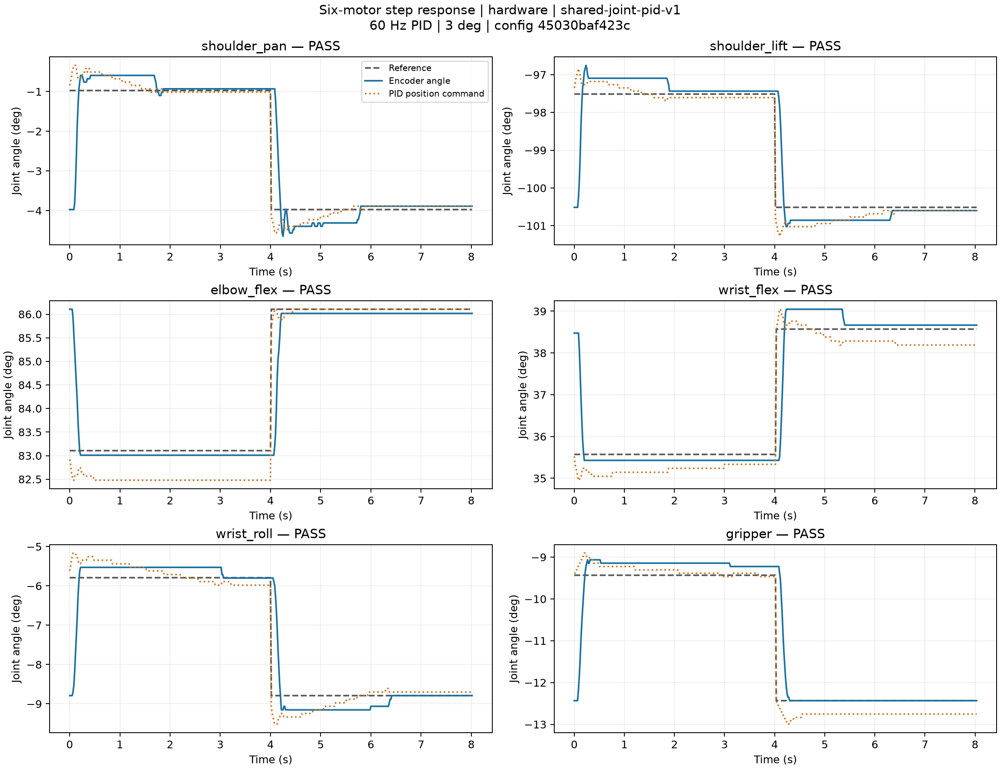

# Control performance and verification

## Shared PID: six physical motors (2026-10-12)

The active profile is `shared-joint-pid-v1`. All normal demos use its 60 Hz software
position PID around the existing native position loop; simulation uses the same PID.
See [the control diagram and design](lerobot-control.md).

The acceptance trial completed all twelve 3° outward/return responses, four seconds each.
The black follower was tested one joint at a time from its current pose; the white leader
remained passive. There was no command fault, feedback gap over 100 ms, or cleanup error.
Native P/I/D and Lock matched the initial readings after exit. Acceleration 254 and
Goal_Velocity 0 were restored; all six motors were left holding with torque enabled.



| Motor | Worst 10–90% rise (ms) | Worst overshoot (%) | Worst ±0.5° settling (s) | Worst tail absolute error (°) | Result |
| --- | ---: | ---: | ---: | ---: | --- |
| shoulder_pan | 89.4 | 22.2 | 0.466 | 0.085 | PASS |
| shoulder_lift | 83.2 | 25.4 | 0.284 | 0.085 | PASS |
| elbow_flex | 109.5 | 3.2 | 0.184 | 0.097 | PASS |
| wrist_flex | 76.3 | 15.2 | 0.168 | 0.143 | PASS |
| wrist_roll | 91.9 | 12.1 | 0.167 | 0.009 | PASS |
| gripper | 117.5 | 12.3 | 0.201 | 0.209 | PASS |

Metrics cover both directions; tail = last 0.75 s. Passing requires reaching 90%,
settling within 3 s and staying within ±0.5°, overshoot ≤35%, and maximum sample gap ≤100 ms.
Timing is derived from approximately 60 Hz samples, so sub-sample interpolated rise times
are estimates rather than sub-millisecond measurement accuracy. This is an encoder test
at one pose and load, not full-workspace robustness or absolute optical tool accuracy.

Config SHA-256: `45030baf423cc4f8069fcfc1c343c2f511f3eea247ab33f6d24044e35e52fc1f`.
Actual native P was **32 / 48 / 80 / 48 / 32 / 32**, I=0 and D=32.
The initial high-gain PID trial reached 76.6% overshoot and failed. Reducing Kp and then
balancing Ki reduced the final worst overshoot to 25.4%.
Intermediate runs are retained under local `logs/pid-hardware-*`; the original and final
summaries are included below. Starting poses differ by a few encoder ticks, so this is
an engineering tuning comparison, not a controlled identification experiment.

- [Hardware summary, per-direction metrics and native settings](measurements/pid-2026-10-12/hardware-summary.json)
- [Initial high-gain PID summary](measurements/pid-2026-10-12/initial-pid-summary.json)
- [CSV](measurements/pid-2026-10-12/hardware-response.csv), [SVG](measurements/pid-2026-10-12/hardware-response.svg), [PDF](measurements/pid-2026-10-12/hardware-response.pdf)
- [Complete report and all six-channel samples (gzip JSON)](measurements/pid-2026-10-12/hardware-result.json.gz)
- [Original full-rate remote trace (gzip JSON)](measurements/pid-2026-10-12/hardware-control.json.gz)

## Simulation and regression checks

The same twelve small-step responses pass in MuJoCo. Its inner actuator approximation
(kp=700, kv=12) is shared across scenes; these are model parameters, not hardware PID registers.
The simulations retain the canonical calibration-bound MJCF file and its fingerprint.
Simulation response is not substituted for the physical response above.

- [Simulation curves](measurements/pid-2026-10-12/simulation-response.png)
- [Simulation metrics](measurements/pid-2026-10-12/simulation-summary.json)
- Local complete suite: **534 passed, 1 skipped** (official LeRobot is installed remotely); includes OpenGL viewer checks.
- Deployed runtime suite: **293 passed**; remote runtime does not require MuJoCo.
- Ruff checks pass on all modified local sources and deployed runtime sources.
- Regression coverage includes PID derivative/filter/reset/load compensation, enable/hold/watchdog/fault handling, calibration and follow mapping, identical prediction/execution, circle contact checks, full Push-T convergence, and pick/carry/release.

Reproduce the finite response trial with:

```sh
./scripts/lerobot-arm verify motors --backend hardware --execute --output logs/new-hardware-response
./scripts/lerobot-arm verify motors --backend mujoco --output logs/new-simulation-response
```

## Dual-arm integration

The live white leader / local simulated follower check completed with both independent
calibrations, current shared parameters and no stream error. The white EEPROM offsets
and limits had been changed externally since the accepted calibration; with explicit
user authorization they were restored and read back. The six measured angle mappings
were preserved. Torque detected after the restoration sequence was explicitly released;
all white channels were verified at Torque_Enable=0 before the final read-only check.
The black arm remains holding. No autonomous physical leader motion was introduced.

- [Dual-arm read-only verification](measurements/pid-2026-10-12/dual-arm-readonly-verification.json)
- [EEPROM before/after and passive-state verification](measurements/pid-2026-10-12/arm1-configuration-restoration.json)

## Historical five-joint comparison (superseded controller)

The following October 9 records used V14–V22 configurations. They are retained as historical
measurements; their gains and compensation are not the current PID settings.

## Five-joint response comparison (2026-10-09)

Supervised physical trials used the same raw waypoints and three-second dwells.
All five arm joints moved together through progressively larger excursions and returns;
maximum per-joint changes were approximately 22, 14, 23, 15 and 29 degrees.
The jaw was not enabled or commanded. Preparation to the common anchor is excluded
from the following metrics. Each plan passed 1,407 local self/floor collision samples
and remote physical-limit and fresh-start checks before execution.

| Configuration / trial | Planned moving time (s) | Moving model RMS / max (mm) | Settled model RMS / max (mm) |
| --- | --- | --- | --- |
| V14 baseline | 6.69 | 5.56 / 15.59 | 1.82 / 3.45 |
| V19: faster trajectory only | 4.26 | 10.51 / 21.02 | 1.60 / 3.04 |
| V21: acceleration and compensation | 4.26 | 8.39 / 19.65 | 1.51 / 2.29 |
| V22: locked session P, first trial | 4.26 | 3.92 / 10.23 | 0.95 / 2.64 |
| V22: independent repeat | 4.26 | 4.05 / 10.73 | 0.65 / 2.87 |

V22 reduced planned moving time by 36.4%. The largest excursion's slowest joint
reached 90% displacement in 0.886 seconds, versus 1.454 seconds for V14, a 39.1%
reduction measured from encoder feedback. Three-second dwells were unchanged;
the total trial wall time is not reduced by 36.4%. Faster trajectory timing alone
increased dynamic error, so V19 was not selected.

V22 uses 60 Hz execution, approach peak speed 0.8 rad/s, minimum duration 0.35 s,
RAM acceleration 40 and velocity 600 ticks/s. First-five-joint feedback filtering
is 80 ms and correction slew is 0.24 rad/s; velocity lead is 0.10 / 0.14 / 0.10 /
0.10 / 0.12 seconds. Session P coefficients are 24 / 24 / 32 / 24 / 24,
written with Lock=1 and restored on close/release. Native I=0, D=32, EEPROM
limits, homing offsets, phase, operating mode and protections are preserved.
Reset retains 0.5 rad/s; circle period and ramp retain 4 s and 1 s.
Postflight readback verified original P=16, Lock=1, restored RAM acceleration
and velocity, unchanged calibration fingerprint registers and zero servo faults.
Temperatures were 26–28 degrees C. Supporting torque remains on for the first five
joints; the jaw remains unpowered.

Errors compare nominal CAD marker positions computed from target and measured
encoder angles. Settled windows cover the last 0.8 seconds of each dwell.
These trials establish response/tracking improvement on this path, not absolute
optical accuracy or a workspace-wide 1 mm claim. Camera observations and latency
are recorded separately; image latency alone does not stop this encoder benchmark.
Motor freshness, connection, fault, tracking and heartbeat guards remain active.
Nominal self/floor checks do not cover unmodeled obstacles. Recorded wrist-roll
angles outside the canonical CAD range are evaluated without clamping; physical
encoder limits are unchanged. Base and tool registration remain unvalidated as
described in [Precision calibration](precision-calibration.md).

```sh
# Physical five-joint motion; close other serial tools and supervise the workspace.
./scripts/lerobot-arm verify response --execute
# Smaller simultaneous excursion only.
./scripts/lerobot-arm verify response --execute --amplitudes 64
```

The default path is relative to the current stable pose. `--anchor path/to/anchor.json`
accepts a saved six-joint raw pose for repeat comparisons, subject to fresh-start,
limit and local collision checks. Evidence is under `logs/response-tuning-20261009/`:
`baseline-v14-retry`, `trajectory-v19`, `feedforward-v21`, `locked-p-v22`,
`confirmed-v22`, `comparison.json` and `restore-proof.json`. Interrupted V20 captures
are excluded. Current control SHA256:
`5c5eb4e26ac58e2ab0c317dc80ef5efebd797b55ad0f52cda28ecfc716319591`.

## Historical circle measurements (2026-10-06)

The circle measurements below used V14: Reset/approach 0.5 rad/s and RAM acceleration 20.
New supervised
gripper-only trials on 2026-10-07 are reported in
[Precision calibration](precision-calibration.md); whole-arm circles have not
been repeated for the new mounting calibration. V14 was restored after the earlier
gripper-only candidate; subsequent five-joint experiments are reported separately.

| Trial | Period / laps | Shoulder RMS / max error (deg) | Elbow RMS / max error (deg) | Model fingertip RMS / max error (mm) |
| --- | --- | --- | --- | --- |
| V14 tuning validation | 4 s / 3 | 0.30 / 1.11 | 0.35 / 1.23 | 2.75 / 8.83 |
| Standard entry recheck | 4 s / 3 | 0.303 / — | 0.345 / — | 2.94 / 7.76 |

The standard entry completed Reset, approach, and three laps, then held with supporting torque retained.
No motor fault was confirmed. The 60 Hz trace contains 780 running frames; maximum circle interval was
18.21 ms, with none exceeding 25 ms. A transient gripper Status=1 returned 0 on independent reread and was recorded as a recovery warning.
Evidence: `logs/responsive-final-client.json`, `logs/tracking-trace-responsive-final.json`, and their analysis outputs.
V14 tuning evidence: `logs/tracking-trial-1791288975334155000.json` and its corresponding tracking trace.

Errors are computed from encoders and calibrated kinematics, not optical measurements.
The experiments cover the current robot, small circle, and Reset path. Peak residual errors remain;
these results do not demonstrate agreement with simulation throughout the workspace.
Previous tuning comparisons and configurations are retained in pre-cleanup source snapshots and historical `.cleanup/` directories.

```sh
./scripts/lerobot-arm view arm --backend hardware --hardware-control
./scripts/lerobot-arm view arm --backend hardware --hardware-control --circle --circle-laps 3
./scripts/lerobot-arm view arm --backend mujoco --circle --circle-laps 3

# Explicit physical verification: executes motion. Close other serial tools first.
./scripts/lerobot-arm verify tracking --execute --laps 3
```

The launcher selects the configured local simulation interpreter.
`diagnostics/circle_tracking.py` uses current shared settings, retains full-rate trajectories and error evidence,
and rejects separate tuning files. Ordinary tracking error does not stop motion; faults, lost torque, and disconnection still trigger hold.
See [Code layout](code-layout.md) for deployment and parameter changes.
