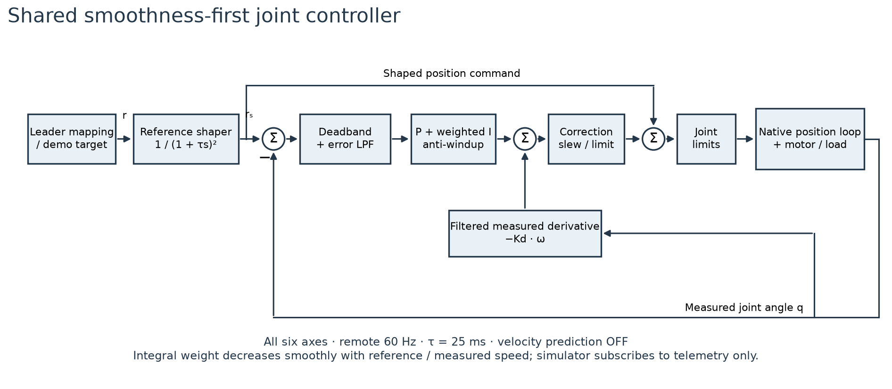
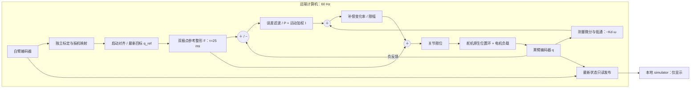

# 统一关节 PID 控制器

所有正常运动入口使用 `configs/control.json` 的 `shared-joint-pid-v1`，频率 60 Hz。
主从跟随、手动、回零、圆轨迹、有限关节轨迹、Push-T 和抓取共用 `PositionFeedback`。
真机由 `ManualControl` 执行，MuJoCo 由 `SimulationControl` 执行。
场景、路径规划、主从角度映射负责生成目标，不再选择另一套电机控制器。



可下载 [SVG](figures/shared-pid-control.svg) / [PDF](figures/shared-pid-control.pdf)。图示包含当前的参考整形、PI-D 反馈和舵机原生闭环。默认已关闭预测性速度前馈。

## 闭环结构

白臂是无主动驱动的输入设备。其独立标定将编码器读数转换为角度，
主从映射将扳机的 0–118° 映射至黑臂夹爪的 0–90°，启动/恢复对齐阶段使用 0.6 rad/s；对齐后每周期直接采用最新目标。
黑臂六个电机各运行一个位置 PID 外环，并由已有舵机内部位置控制执行命令。
所有内部计算使用标定后的 rad，图表转换为 deg。

每个关节在第 k 次控制更新时：

```text
q_s     = F(s) q_ref, F(s) = 1 / (1 + 0.025 s)^2
          # 双极点参考整形；精确零阶保持离散更新，初始状态取实测位置
e       = deadband(q_s - q)
e_f     = lowpass(e, tau_error)
omega_f = lowpass((q[k] - q[k-1]) / actual_dt, tau_D)
v_ref   = lowpass((q_s[k] - q_s[k-1]) / actual_dt, tau_reference)
w       = 1 / (1 + (max(abs(v_ref), abs(omega_f)) / 0.25)^2)
I_next  = I + Ki * e_f * w * dt   # 含限幅和抗饱和
u_pid   = slew(Kp * e_f + I - Kd * omega_f, pid_rate)
q_cmd   = clip(q_s + bounded_correction(u_pid), joint_limits)
```

2026-10-13 起默认以平滑优先。旧速度预测在连续两帧变化时开启、单帧停顿时清零，
量化输入可使其频繁开关；旧实录中参考变化小于 0.3° 时也出现了 1–3° 命令跳变。
六关节的 `velocity_feedforward_s` 现在统一为 0。
双极点参考整形不外推目标，阶跃参考本身单调收敛；这不等于实际电机绝不超调。
其低频延迟约 50 ms，离散采样与电机本身另有延迟。运动时降低积分学习速度，
保留已学到的静态负载补偿，避免将动态滞后积累为停止后的持续推力。
当前仍有饱和、死区与速率限制，不能把整个系统视为一个线性 PID 传递函数。

同一配置覆盖所有 demo。圆轨迹默认周期从 4 s 调整到 16 s，以保留原有
最大关节跟踪误差 <0.01 rad、末端误差 <5 mm 的仿真标准；没有放宽验收阈值。


`q_ref` 是原始名义目标，`q_s` 是整形后的名义位置。D 对测量微分，目标阶跃不会产生微分冲击。
`I` 的单位为 rad；`Kp` 无量纲，`Ki` 为 1/s，`Kd` 为 s。
积分在补偿幅值或物理边界饱和且误差继续推向边界时冻结，反向误差允许积分释放。
输出补偿另有变化率限制。相邻轨迹的正常驻留保留已学到的负载补偿；
重新使能、显式保持、故障和复位会清空相关 PID 状态。
超过 100 ms 的单次控制间隔冻结积分并清除测量速度估计，补偿积分步长最多 50 ms。
通信看门狗仍独立工作；恢复通信后需要明确恢复控制。

| 关节 | Kp | Ki (1/s) | Kd (s) | 总补偿上限 (rad) | PID 反馈变化率 (rad/s) |
| --- | ---: | ---: | ---: | ---: | ---: |
| shoulder_pan | 0.12 | 1.20 | 0.02 | 0.20 | 0.24 |
| shoulder_lift | 0.10 | 0.80 | 0.03 | 0.16 | 0.24 |
| elbow_flex | 0.25 | 1.50 | 0.02 | 0.16 | 0.24 |
| wrist_flex | 0.10 | 0.80 | 0.02 | 0.16 | 0.24 |
| wrist_roll | 0.20 | 0.80 | 0.015 | 0.20 | 0.30 |
| gripper | 0.35 | 0.80 | 0.01 | 0.12 | 0.04 |

D 滤波时间常数为 shoulder_lift/wrist_roll 40 ms、其他关节 80 ms；误差滤波为 wrist_roll 40 ms、夹爪 120 ms、其他关节 80 ms。
死区为 pan/wrist_flex/wrist_roll 0.0015 rad，lift/elbow/gripper 0.003 rad。
物理编码器边界始终约束最终命令，Push-T 另取 CAD 边界交集。

## 执行器与实现边界

当前 Feetech 接口提供 `Goal_Position`、`Goal_Velocity`、`Acceleration` 和
`Present_Current`，没有独立的 `Goal_Current`。因此没有把参考图中的独立电流 PID
或速度 PID 标成已实现。速度估计用于位置 PID 的微分阻尼。
原生位置环、驱动和机械负载共同构成外环的被控对象。

使能前写入并核对当前角度的保持目标，再开启力矩。所有正常运动入口使用 RAM
Acceleration=254、Goal_Velocity=3000 ticks/s，并在退出/释放时恢复使能前值。
**原生 P/I/D、EEPROM、工作模式、限位和保护参数不被这套软件 PID 改写。**
`native_defaults` 中 P=16/I=0/D=32 是上游版本参考值，不能作为现场实际读数。
本次现场 P 为 32/48/80/48/32/32，测试报告记录实际值。

MuJoCo 使用相同的 PID 算法、频率和配置，但内部位置执行器、摩擦、负载和通信延迟
并不等价于真机。所有仿真场景的内部位置执行器统一为 kp=700、kv=56，
由 `simulation_actuator` 配置，力矩上限沿用各场景模型；这些数值不是舵机寄存器值。
只修改编译后的 MuJoCo 模型，不改动标定绑定的原始 MJCF。
不能把仿真阶跃结果当作电机实测结果。
预测分支同时复制物理状态和 PID 状态，防止积分/滤波历史导致预测与执行不一致。
原始编码器电气诊断 `hardware move`/夹爪连通性检测保留其有限步进与保护逻辑；
它们不作为 demo 控制器或本次性能验收入口。

## 响应曲线与复现

```sh
# 本地六轴阶跃仿真
./scripts/lerobot-arm verify motors --backend mujoco --output logs/pid-simulation

# 远端真机六轴小幅往返；先做标定一致性、限位与模型碰撞检查
./scripts/lerobot-arm verify motors --backend hardware --execute --output logs/pid-hardware
```

默认从当前姿态逐轴做 3° 阶跃和返回，每段记录 4 s。允许范围为幅度 1–5°、
记录时间 3–10 s。完整轨迹、60 Hz 编码器与 PID 命令、配置 SHA、原生增益、标定 SHA
保存在 `result.json`、`control.json`、`response.csv`；曲线输出 PNG/SVG/PDF。
退出或异常时先保持机械臂，再下载/分析数据。

每个方向分别统计 10–90% 上升时间、到达 90% 时间、超调、±0.5° 调节时间、
最后 0.75 s 的稳态误差及全段 RMS。未达到的指标保留 null，不能用 0 代替。
验收条件：到达 90%、3 s 内进入并保持 ±0.5°、超调不超过 35%、反馈最大间隔不超过 100 ms。
这是当前姿态小阶跃的工程验收，不代表整个工作空间、所有负载或光学末端精度。
白臂是被动输入，六条电机响应对应黑臂六个受控通道。

## 部署

修改唯一参数源后运行 `./scripts/deploy_code.sh`，然后重启两端进程。
握手校验配置 SHA-256；旧进程或旧参数不能静默混用。
`configs/follow.json` 仅保留角色、标定、扳机映射和初始化参数；旧的控制器/频率覆盖字段会被拒绝。

参考：上游 [SO follower](https://github.com/huggingface/lerobot/blob/main/src/lerobot/robots/so_follower/so_follower.py)、
[Feetech 寄存器表](https://github.com/huggingface/lerobot/blob/main/src/lerobot/motors/feetech/tables.py)、
[ST3215 文档](https://www.waveshare.com/wiki/ST3215_Servo)。


## 远端独立控制与历史参数

2026-10-12 至本次更新前曾使用 60–100 ms 速度预测补偿以降低延迟。
该参数已被当前平滑优先配置替代；历史曲线不能作为当前配置验收。
启动对齐仍使用 0.6 rad/s，随后名义目标采用最新映射值，并经过共享参考整形。

跟随由远端 standalone 进程独立拥有双臂串口，启动和保持只接受其控制终端输入。
采集、标定、映射、PID 和写电机全部在远端完成；看门狗检查远端采集与循环间隔。
只读 Unix socket 通过独立线程向观察端发送最新帧，不读取命令。观察端堵塞、断开或失焦不影响跟随。
控制终端退出仍保持黑臂；硬件报警仍保持并要求显式恢复。

仿真内环的 kv/kp 约为 80 ms，用于近似实测舵机的低频响应，避免将真机前馈应用到过快的理想执行器。
这只是内环模型近似，不是硬件寄存器或完整系统辨识。抓取和 Push-T 的预测、执行使用相同控制状态与参数。
最新实测曲线、超调对比及未完成验收见[远端控制测试](measurements/remote-follow-2026-10-12/README.md)。
Push-T 候选预测同时检查闭环执行后的接触高度，并在块末尾允许最多 0.6 s 的有限稳定时间；
不再只根据理想 IK 姿态接受接触动作，预测与执行保持一致。


## 远端跟随中的控制框图



测量微分与参考处理的设计依据可参阅 MathWorks 的
[PI-D 控制说明](https://www.mathworks.com/help/slcontrol/ug/create-i-pd-and-pi-d-controllers.html)。
本项目新增双极点参考整形和运动积分权重；没有声称实现独立速度环/电流环。
测试证据见[平滑跟随报告](measurements/follow-smoothing-2026-10-13/README.md)。
