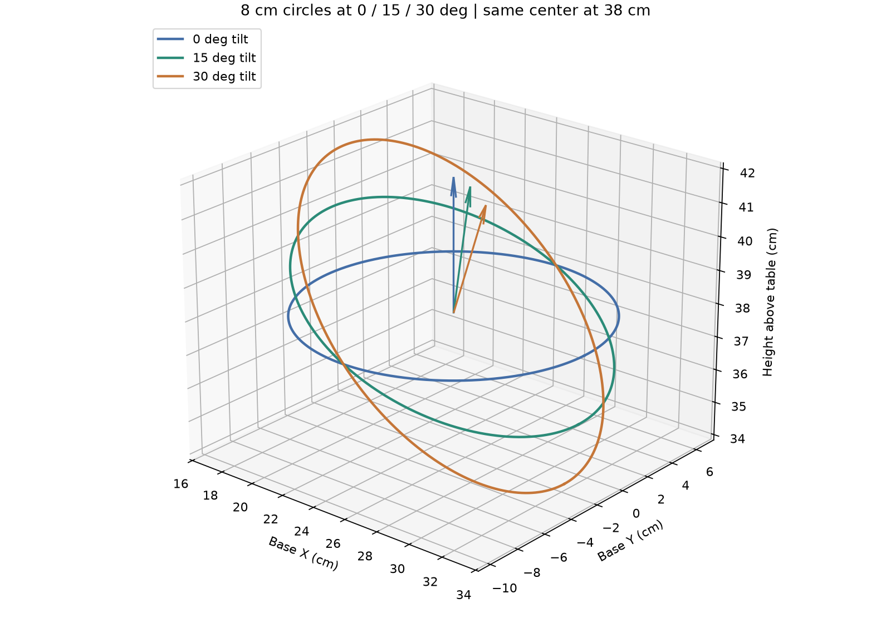
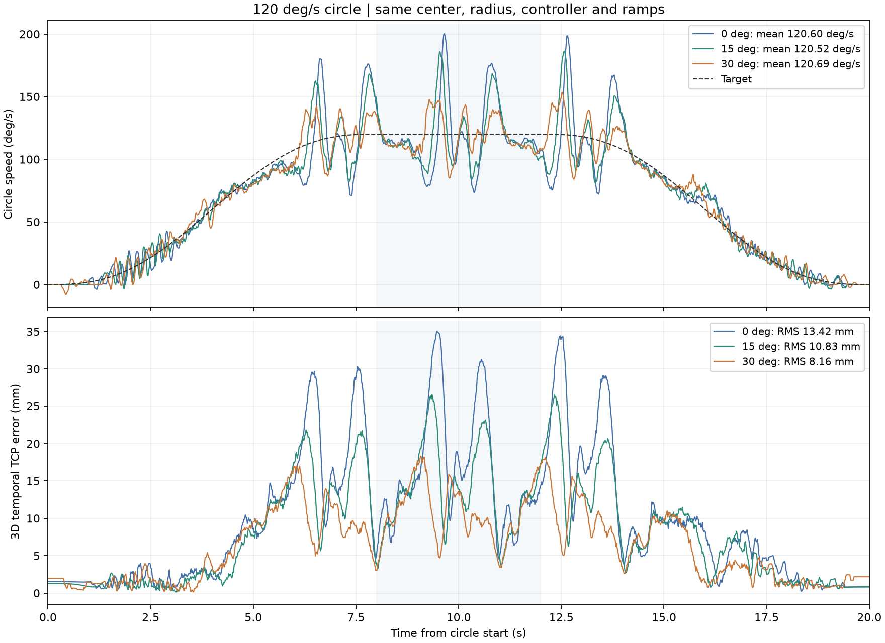

# 圆平面倾角对比：0° / 15° / 30°

三组各完成四圈真机测试，均无报警。用户确认 15°、30°
“两种倾角都平顺，可以接受”。30° 的本轮时序 RMS 最低，但仍未达到
5 mm 动态精度，不能由此推断整个工作空间的最佳倾角。

三组使用同一圆心、半径和控制器，改变的是圆平面相对桌面的倾角。
中心在桌面以上 38 cm，半径 8 cm，目标圆周相位速度 120°/s。
每轮四圈、每端 8 秒五次速度渐变，圆周阶段约 20 秒。
原生 RAM 加速度均为 16→48→16，PI、前馈、滤波和原生 P/I/D 均不变。



## 几何定义与规划

基座坐标圆心为 `[0.25, -0.017, 0.3775999983] m`，
桌面 `z=-0.0024000017 m`。绕基座 Y 轴旋转，离基座更远的一侧降低：

```text
u = [cos(θ), 0, -sin(θ)]
v = [0, 1, 0]
normal = u × v
position(φ) = center + 0.08 × (u cos(φ) + v sin(φ))
```

工具倾角相对基座偏航保持原约束，并不沿圆法向转动。
5 号腕转和 6 号夹爪保持当前固定姿态；本次不构成这两轴的动态验收。

| 圆平面倾角 | TCP 桌面高度范围 | 最大规划关节速度 | 最大采样关节加速度 |
|---|---:|---:|---:|
| 0° | 38.00 cm | 85.20°/s | 268.63°/s² |
| 15° | 35.93–40.07 cm | 75.89°/s | 220.12°/s² |
| 30° | 34.00–42.00 cm | 67.40°/s | 203.02°/s² |

三个路径均符合既有 90°/s、300°/s² 关节命令预算，最小已示教范围余量
约 8.50°。完整筛选见 [screen.json](screen.json)。
这些是参考命令的预算，并非实测速度或精度保证。

CAD 自碰撞、桌面碰撞、关节范围与倾斜平面几何检查通过。
每轮进入段根据刚读取的实际姿态重新检查，并上传绑定当前模型、路径、
标定、控制配置和初始姿态的证明；远端再次检查预算和原生限位后才启动。
没有使用旧 Reset。原始近似动力学仍未通过 5 mm / 0.01 rad 精度门槛，
其失败结果保留在 [planning.json](planning.json)，没有改写成精度通过。

## 运行与响应记录

| 倾角 | 匀速段平均速度 | 3D 时序 RMS / 最大误差 | 几何圆 RMS | ≥3 Hz 残差 RMS |
|---|---:|---:|---:|---:|
| 0° | 120.60°/s | 13.42 / 35.03 mm | 7.98 mm | 0.65 mm |
| 15° | 120.52°/s | 10.83 / 26.56 mm | 5.98 mm | 0.54 mm |
| 30° | 120.69°/s | 8.16 / 18.33 mm | 5.42 mm | 0.80 mm |

误差包含圆周启停，排除进入段；平均速度仅拟合匀速段。
7 帧平均（约 117 ms）圆周速度 P5–P95 分别为
79.43–175.85、91.21–166.90、96.84–144.62°/s，速度波动仍然明显。
30° 的时序误差和速度波动较低，但高频残差没有改善；本次没有调整 PID。
规划显示肩关节速度和加速度需求随该倾斜方向降低，与时序误差下降相符，
但不是已辨识出的唯一误差原因。所有结果只涵盖本场景、空载和当前标定。



- 0°：[完整指标](tilt00-report.json)、[TCP 曲线](tilt00-trajectory.png)、[六关节曲线](tilt00-joints.png)。
- 15°：[完整指标](tilt15-report.json)、[TCP 曲线](tilt15-trajectory.png)、[六关节曲线](tilt15-joints.png)。
- 30°：[完整指标](tilt30-report.json)、[TCP 曲线](tilt30-trajectory.png)、[六关节曲线](tilt30-joints.png)。

0° 复用 `table-circle120-h38cm.json`，本次另有新的实机基线记录。
15°、30° 分别使用 `table-circle120-tilt15.json`、`table-circle120-tilt30.json`。

```sh
./scripts/lerobot-arm verify tracking --execute --from-current --laps 4 \
  --plan data/trajectories/table-circle120-tilt15.json
```

将 `tilt15` 改为 `tilt30` 可运行另一角度，使用匹配设备标定、空载夹爪、
已检查的现场空间和监督条件。所有真实参考生成与控制在远端完成，
simulator 只读取，运动结束后才在本地绘图。

倾斜场景声明 `plane: "inclined"` 和两个有限、单位正交的 `plane_basis` 向量。
远端校验、几何检查和响应投影共用 `circle_frame`，错误基向量或错误平面
在运动前拒绝。相位、半径和法向偏差按真实平面计算；TCP 时序误差仍为
完整 3D 距离，不把沿倾斜平面的上下运动当成平面外误差。

`tilt*-control.json.gz` 保存完整控制帧，`tilt*-plan.json` 为精确路径快照。
指标中的 trace SHA256 对应解压后的 JSON。所有 TCP 指标均由编码器与
标定 CAD 推算，不是独立相机测量；平均速度也不能代替瞬时速度和精度验收。

## 参数恢复与软件验收

三组运行期均读回首末加速度 16、匀速中段 48；控制约 60 Hz，
圆周帧最大间隔分别为 18.54、17.98、18.16 ms。
[最终只读核对](final-readback.json) 确认六轴原生 P/I/D、零点、相位、
原生限位、死区、启动输出和积分限制与上一轮一致，Status=0、Lock=1、
Torque_Enable=1、Acceleration=0、Goal_Velocity=0，温度 25–28°C。
保留扭矩支撑，最后停在 30° 圆的起终点姿态。

本地完整回归 **793 passed, 1 skipped**（可选 LeRobot SDK 对照未安装），
远端部署内容完整回归 **537 passed**，Ruff 与差异空白检查通过。
新增测试覆盖非法/非正交平面、缺失桌面与标定身份、固定轴被修改、
错误平面几何、合成倾斜圆速度恢复及两条远端有限任务的故障保持和参数恢复。
模型、标定和控制参数没有修改；本地与远端路径/配置哈希一致。
汇总和部署核对见 [summary.json](summary.json)、[verification.json](verification.json)。
