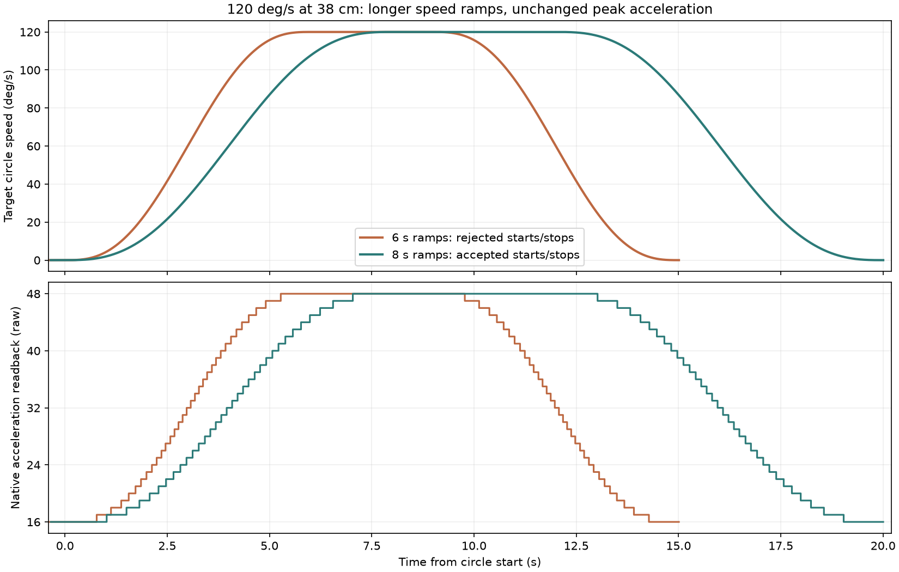
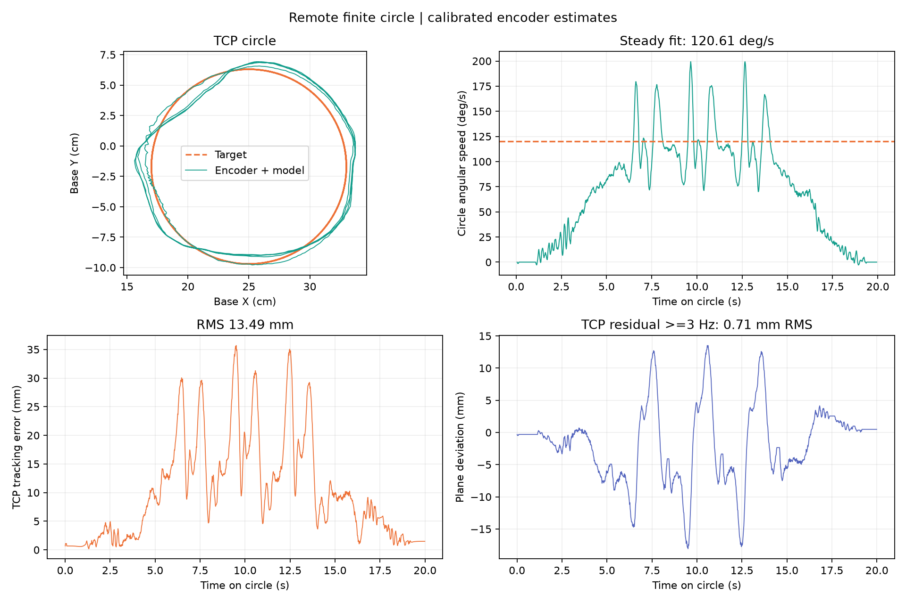

# 38 cm 高度、半径 8 cm、120°/s 圆周实验

最终 8 秒渐变、四圈实机测试平均 **120.61°/s**，无报警。
用户确认“启停已平顺，可以接受”。该结果只代表当前空载场景的启停验收，
瞬时速度仍明显波动，精度未达到 5 mm。

目标为圆周相位 120°/s，即匀速每圈 3 秒，TCP 线速度约 16.76 cm/s。
关节速度与圆周相位速度不同。控制与参考生成都在远端计算机运行，
simulator 不参与真实闭环。

## 工作范围与预算

保留上一轮已验证的 38 cm 桌面高度、XY 圆心 `[0.25, -0.017] m`、
工具倾角和夹爪姿态。桌面在基座坐标 `z=-0.0024000017 m`，
TCP 圆平面 `z=0.3775999983 m`，5/6 号关节保持不变。

配置仅将显式请求的圆周相位上限从 90 提高到 120°/s，
原有各关节 90°/s、300°/s² 命令预算保持原值。
[高度筛选](height-screen.json) 的完整路径采样结果：

| 桌面高度 | 最大关节速度 | 最大采样关节加速度 | 结果 |
|---|---:|---:|---|
| 34 cm | 106.14°/s | 390.23°/s² | 超出预算，不执行 |
| 36 cm | 93.99°/s | 317.87°/s² | 超出预算，不执行 |
| 38 cm | 85.20°/s | 268.63°/s² | 符合命令预算 |

几何、CAD 自碰撞与桌面碰撞检查通过，进入段每次根据当前实测姿态重新验证。
原生限位、已示教的软件范围、报警/失扭矩/受阻保持、反馈看门狗和有限执行期限均保留。
用户确认在旁、空载且清空原运动空间后，才执行实机实验。

[近似动力学](planning.json) 没有通过原来的 5 mm / 0.01 rad 精度门槛，
该失败结果保留。它不完整模拟原生寄存器轨迹限制，因此几何/预算通过
只能支持本次监督性能实验，不能记为动态精度通过。

## 参数与首轮对比

`smooth-circle120-v1` 继承圆轨迹共用控制算法、PI、速度前馈和滤波。
仅为这个显式档位设置原生 RAM 加速度 `16→48→16`，随五次速度渐变调度，
每次整数值变化都读回验证，并受各电机原有 Maximum_Acceleration 限制。
失败立即保持，退出恢复原始 RAM。60/90°/s 档位、原生 P/I/D、EEPROM、
零点和限位均保持原值。完整配置见 [control.json](control.json)。

首轮每端渐变 6 秒、三圈，实测平均 118.09°/s，时序 RMS 13.31 mm、
最大误差 35.59 mm，几何圆 RMS 8.03 mm。用户反馈“启停仍有明显顿挫”，
**该轮未通过启停平顺性验收**。保留 [指标](baseline-r6-report.json)、
[路径](baseline-r6-plan.json)、[TCP 曲线](baseline-r6-trajectory.png)、
[六关节曲线](baseline-r6-joints.png) 及 `baseline-r6-control.json.gz`。

后续把每端渐变延长到 8 秒，使目标相位加减速强度接近已接受的
90°/s、6 秒方案。四圈圆周阶段约 20 秒，包含 4 秒匀速阶段。
用户确认“启停已平顺，可以接受”，保留为当前 120°/s 方案。



| 指标 | 6 秒渐变、三圈 | 最终 8 秒渐变、四圈 |
|---|---:|---:|
| 匀速段平均相位速度 | 118.09°/s | 120.61°/s |
| 时序 TCP RMS / 最大误差 | 13.31 / 35.59 mm | 13.49 / 35.69 mm |
| 几何圆 RMS | 8.03 mm | 8.08 mm |
| ≥3 Hz 跟踪残差 RMS | 0.68 mm | 0.71 mm |
| 肉眼启停 | 明显顿挫 | 可以接受 |

指标包含圆周起停，排除进入段；平均速度只拟合匀速段。
最终 7 帧平均（约 117 ms）速度 P5–P95 为 **78.37–175.56°/s**，
说明平均达到目标并不等于瞬时速度恒定。2 号肩关节仍是主要误差来源。
延长渐变改善了启停观感，没有改善厘米量级轨迹误差。

[完整指标](h38-report.json)、[六关节响应](h38-joints.png)、
[TCP 与速度曲线](h38-trajectory.png) 保留原始结果；完整记录为
`h38-control.json.gz`。最终控制约 60 Hz，圆周帧最大间隔 17.81 ms。
观察端累计周期统计曾显示 58.62 ms，覆盖初始化；不能把它当作圆周阶段帧间隔。
首次和末次加速度读数全为 16，匀速中段全为 48，六轴无报警。



## 复现

```sh
./scripts/lerobot-arm verify tracking --execute --from-current --laps 4 \
  --plan data/trajectories/table-circle120-h38cm.json
```

必须使用匹配的当前设备标定和检查过的空载运动空间，现场有人监督。
进入阶段仍限速 0.1 rad/s，没有调用旧 Reset 或绕过其身份核对。
以上原生命令预算不等于实测关节速度上限或光学精度保证。

原始控制帧保存为压缩 JSON，指标中的 SHA256 对应解压后的文件。
TCP 由编码器与 CAD 推算，不是外部相机测量。5/6 号保持固定，
本次不构成它们的动态响应验收。

[最终只读核对](final-readback.json) 确认原生 P/I/D、零点、相位、限位、
死区、启动输出和积分限制与上一轮一致，六轴 Status=0、Lock=1、
Torque_Enable=1、Acceleration=0、Goal_Velocity=0，温度 25–27°C。
配置、路径和标定本地/远端哈希一致。软件测试与部署结果见
[verification.json](verification.json)。

本地完整回归 **769 passed, 1 skipped**（可选 LeRobot SDK 对照未安装），
远端部署内容完整回归 **517 passed**，Ruff 与差异空白检查通过。
