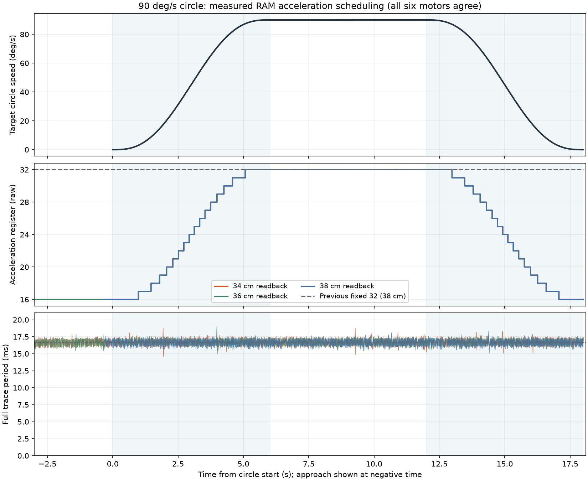

# 90°/s 圆周启停修复：分阶段原生加速度

34、36、38 cm 桌面高度各完成半径 8 cm、三圈实机复测。
用户先确认 38 cm “启停已平顺，可以接受”，随后确认 34/36 cm
“两轮都可以接受”。六轴全程无报警。

本次通过的是这些场景下的肉眼启停平顺性验收。
瞬时速度波动和厘米量级时序误差仍存在，尚未达到 5 mm 动态精度。
TCP 来自编码器和标定 CAD，不是独立光学测量。

## 改动与依据

[上一轮固定加速度 32](../table-circle90-height-2026-10-18/README.md)
虽然平均圈速接近目标，用户仍反馈“启停仍有明显顿挫”。
固定使用 16 的早期 90°/s 实验又出现最大 132.89 mm 跟踪误差，
所以本次保留匀速段 32，仅降低进入和低速启停段的原生加速度。
这是经过对比验证的处理方案，不代表已经辨识出唯一机械或控制根因。

`smooth-circle90-v2` 继续使用统一控制器及原来的外环 PI、速度前馈、滤波，
两个端部各保留 6 秒五次速度渐变。令同一时刻的归一化速度为 s（0–1）：

```text
Acceleration = round(16 + 16 × s)
进入/起步：16 → 匀速：32 → 停车：16
```

调度按各电机原生 Maximum_Acceleration 再限幅，仅在整数值变化时
同步写 RAM 并读回确认；失败立即进入保持。正常完成和关闭后恢复原始 RAM。
故障保持不等待渐变。未修改原生 P/I/D、EEPROM、零点、限位或保护。
真实参考生成和控制全部在远端运行，simulator 只读取；运动结束后才绘图。
60°/s 圆和普通跟随的配置未改变。



图中六个电机的加速度读数一致。三个高度全程观察到 16–32，
匀速中段全部为 32，首末帧全部为 16。控制约 60 Hz，完整记录最大周期
分别为 18.80、19.01、18.36 ms，调度未造成长时间停顿。
读回遥测来自控制写入前的采样，变化可在下一帧反映。

## 实测与剩余误差

误差包含圆周起停，排除进入段；平均速度仅拟合匀速段。
三圈共约 18 秒，匀速部分每圈 4 秒；进入段另外计时。

| 桌面以上高度 | 平均圆周速度 | 时序 RMS / 最大误差 | 几何圆 RMS | ≥3 Hz 残差 RMS | 肉眼启停 |
|---|---:|---:|---:|---:|---|
| 34 cm | 89.73°/s | 13.00 / 33.07 mm | 7.83 mm | 0.45 mm | 可以接受 |
| 36 cm | 89.71°/s | 10.66 / 24.68 mm | 6.32 mm | 0.50 mm | 可以接受 |
| 38 cm | 89.65°/s | 9.76 / 21.27 mm | 5.98 mm | 0.49 mm | 可以接受 |

相较固定 32，时序 RMS 分别由 12.74/10.49/9.64 mm 变为
13.00/10.66/9.76 mm，精度没有改善，启停观感改善。
7 帧平均（约 117 ms）圆周速度 P5–P95 分别为
58.95–138.08、68.03–123.64、71.90–118.47°/s，仍有显著低频波动。
2 号肩关节仍是主要跟踪误差来源；小幅高频残差不能代替完整轨迹误差。
5 号腕转和 6 号夹爪保持固定，本次不构成它们的动态验收。

- 34 cm：[指标](h34-report.json)、[TCP 曲线](h34-trajectory.png)、[六关节曲线](h34-joints.png)。
- 36 cm：[指标](h36-report.json)、[TCP 曲线](h36-trajectory.png)、[六关节曲线](h36-joints.png)。
- 38 cm：[指标](h38-report.json)、[TCP 曲线](h38-trajectory.png)、[六关节曲线](h38-joints.png)。

三个场景继承上一轮的圆心、工具倾角和空间筛选，桌面基座 Z 为
−0.0024000017 m，三个 TCP 平面基座 Z 为 0.3375999983、
0.3575999983、0.3775999983 m。沿用与实测匹配的零点和 CAD。
既有近似动力学未通过严格精度检查的事实仍保留在上一轮报告中；
没有把本次视觉接受改写成模拟精度通过。

## 复现与验证

```sh
./scripts/lerobot-arm verify tracking --execute --from-current --laps 3 \
  --plan data/trajectories/table-circle90-h38cm.json
```

改用 `h34cm` 或 `h36cm` 选择另一个高度。仅适用于当前标定、空载夹爪、
已检查的无干涉空间和现场监督；三条路径都绑定 `smooth-circle90-v2`。
有限任务的加减速不能重叠，因此本组参数请保持三圈。

本地完整测试 **765 passed, 1 skipped**，远端部署内容完整测试 **513 passed**。
Ruff 与差异空白检查通过。测试覆盖调度端点、原生最大值限幅、重复写消除、
错误读回保持、临时 RAM 恢复以及远端有限圈任务。
本地可选 LeRobot SDK 对照未安装而跳过，远端完整测试覆盖已部署模块。

[最终只读核对](final-readback.json) 确认原生 P/I/D、零点、限位和启动参数
与上一轮一致，六轴 Status=0、Lock=1、Torque_Enable=1、
Acceleration=0、Goal_Velocity=0，温度 25–27°C。
配置、三条路径和标定的本地/远端哈希一致。

[summary.json](summary.json) 保留参数、路径和解压后原始帧的 SHA256；
`h*-control.json.gz` 保存完整控制记录，[control.json](control.json) 保存配置快照。
软件、部署和肉眼反馈记录在 [verification.json](verification.json)。
