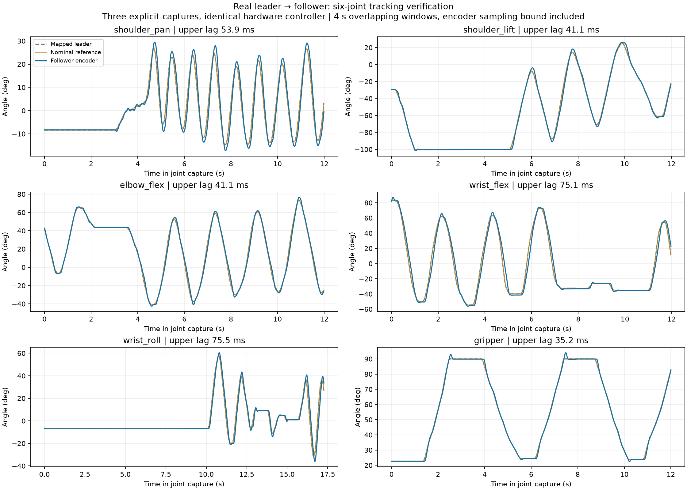

# Follow latency acceptance — 2026-10-12

The six joints passed encoder-to-encoder tracking-lag acceptance on the recorded bidirectional motions. This is a **three-capture, joint-by-joint result**, not one uninterrupted six-axis pass. All three used identical hardware PID, feedforward, native RAM and follow settings. It does not guarantee arbitrary speed, pose, payload or simultaneous multi-axis motion.



| Motor | Worst estimated lag + sampling bound (ms) | Valid 4 s windows | Reference span (°) | Largest window speed p95 (rad/s) | Tracking RMS (°) |
| --- | ---: | ---: | ---: | ---: | ---: |
| shoulder_pan | 53.9 | 7 | 41.6 | 2.12 | 2.44 |
| shoulder_lift | 41.1 | 6 | 125.1 | 2.71 | 1.82 |
| elbow_flex | 41.1 | 8 | 114.5 | 3.02 | 2.22 |
| wrist_flex | 75.1 | 8 | 138.2 | 4.31 | 5.70 |
| wrist_roll | 75.5 | 7 | 89.6 | 3.32 | 3.53 |
| gripper | 35.2 | 7 | 67.3 | 1.22 | 0.72 |

## Measurement definition

Both encoders and commands are timestamped on the remote monotonic clock. Each four-second window must include a reversal and at least 4° input movement. A delay/scale/offset fit searches −100…500 ms in 2 ms increments. Acceptance requires R² ≥0.85, gain 0.65…1.35, at least two valid windows, no failed candidate window, and fitted nonnegative lag plus the largest encoder sampling interval below 100 ms. Windows overlap by three seconds; they are not independent repetitions. This operational sampling allowance is not a statistical confidence interval. Static/straight-ramp windows cannot claim a zero-delay pass. The test measures dynamic phase lag separately from absolute tracking error; the table therefore also reports RMS angle error.

The white trigger is mapped from 0–118° to the black jaw’s 0–90° before comparison. Reports include only the labelled joint and `following` stage; startup alignment, pauses and stopped workers are excluded. Read-to-command p95 was 5.75–5.84 ms (maximum 6.89 ms). This transport/control timing alone is not the motor-following result.

## Captures and unsuccessful cases

- [Main report](main-report.json): shoulder pan/lift, elbow and wrist flex passed. Fast wrist roll failed; its full report and trace retain that failure. The trigger was not moved.
- [Wrist repeat](wrist-report.json): all seven wrist windows passed. After that joint’s completed stage, the session encountered an id 6 input-voltage error during the trigger stage. The error caused hold and remains recorded. This is not a fault-free full-session acceptance. A later read-only check found both arms fault-free; no voltage limits or supply settings were changed.
- [Trigger repeat](trigger-report.json): user confirmed prior non-movement; the dedicated 12-second repeat captured seven passing windows and completed normally.
- [Baseline](baseline-report.json) and [fast tuning run](fast2-report.json): preserve failures. Rapid hand motions exceeding available servo speed still fail; in the main capture wrist speed reached approximately 6.7 rad/s and lag exceeded 100 ms. Slower wrist repetition passed. There is no software guarantee for arbitrarily fast leader motion.

Full-rate evidence: [main](main-trace.json.gz), [wrist](wrist-trace.json.gz), [trigger](trigger-trace.json.gz), [baseline](baseline-trace.json.gz), [fast tuning](fast2-trace.json.gz). [Combined summary](summary.json) names the source trial for every joint. Curves also available as [SVG](six-motor-follow.svg) and [PDF](six-motor-follow.pdf).

## Exact configuration and response checks

Measured control SHA-256: `97dbb83430eddeab1c288864e619f8322b4630d32343f40846b6ce3a0ec1e1bd` ([file](measured-control.json)).

Deployed control SHA-256: `3ab417ffb21a34849e78ad94e8e01360cd643d6ae79d035da773990b8df2c718` ([file](deployed-control.json)).

The only difference is the MuJoCo inner-actuator approximation: kv changes from 12 to 56 with kp=700, giving an approximately 80 ms low-frequency lag. Hardware parameters are byte-equivalent as parsed JSON. The final hardware and simulation step tests use the deployed full configuration. The canonical calibration-bound MJCF and both independent calibration files are unchanged.

The older idealized inner actuator responded much faster than the measured servos. Applying real-servo velocity lead to it caused overshoot and loss of grasp/push contact. The shared PID is retained without per-demo gain overrides; prediction and execution use the same actuator approximation. The approximate 80 ms time scale is supported by [first-order-plus-delay fits](native-lag-fit.json) to the saved small-step data (median delay + time constant 84 ms; individual estimates 66–140 ms), but it is not full nonlinear servo identification. Contact simulation does not establish real pick/place success.

All twelve final 3° outward/return hardware steps passed the existing response thresholds, and native RAM restoration was verified. White leader torque remains off. Step settling/rise time is a different measurement from continuous tracking phase lag and is not required to be under 100 ms.

- [Final hardware step summary](hardware-step-summary.json), [curves](hardware-step-response.png), [CSV](hardware-step-response.csv), [full report](hardware-step-result.json.gz), [remote trace](hardware-step-control.json.gz).
- [Final simulation step summary](simulation-step-summary.json), [curves](simulation-step-response.png), [CSV](simulation-step-response.csv), [full report](simulation-step-result.json.gz).

## Reproduction

```sh
./scripts/lerobot-arm demo follow --start-held --latency-test
# Press E, then move only the indicated joint. Space holds.
./scripts/lerobot-arm demo follow --start-held --latency-test --latency-joints gripper
./scripts/lerobot-arm verify follow-latency docs/measurements/follow-latency-2026-10-12/trigger-trace.json.gz --joints gripper --output /tmp/trigger-report.json --plot /tmp/trigger.png
```

Acquisition saves client state, full-rate remote trace, JSON metrics and six-panel curves next to `--log`. Explicit subset acceptance is recorded in `required_joints`; it does not pass unmeasured axes. Analysis exits with code 2 if acceptance fails. The default requires all six joints.

## Final regression and deployment verification

- Local complete suite: **561 passed, 1 skipped**, including viewer, full Push-T convergence and unwelded pick/carry/release.
- Remote runtime suite: **307 passed** under the installed hardware environment; these are mocked-bus regression tests, separate from physical trials above.
- Ruff and `git diff --check`: pass.
- [Deployment and postflight](deployment-and-postflight.json): **96 shared files match**, both six-joint calibration fingerprints match, all twelve status flags are zero. Black torque is on for hold, white torque is off; original native P/I/D/Lock and RAM settings are retained/restored.
