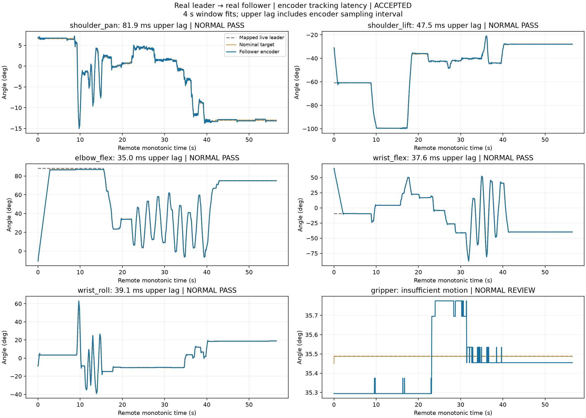
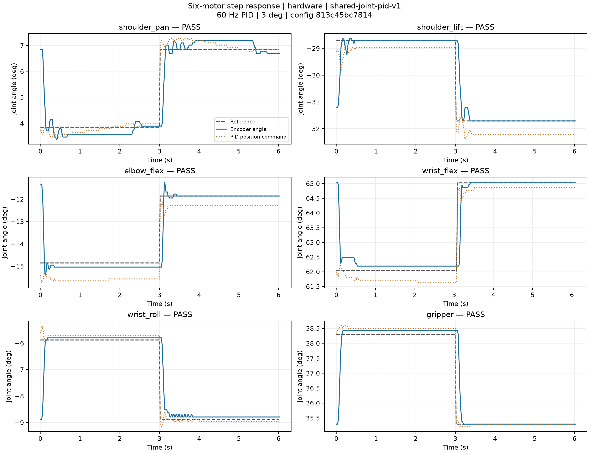

# Wrist latency retuning and online warnings — 2026-10-13

The shared controller is deployed on the robot computer. Acquisition, mapping, PID and
motor commands remain remote; the simulator is an optional read-only observer.
The current **six-axis normal-speed acceptance is incomplete**. Motors 1–5 have
accepted normal-speed windows in one fault-free recording. Motor 6 has a separate
65.1 ms passing recording at higher input speeds, but no accepted recording inside
the agreed normal-speed envelope. Recurrent white-arm voltage-error packets interrupted
further acquisition. A finite step-response pass does not replace this missing evidence.

## Exact configuration and changes

[Shared control.json](control.json) SHA-256:
`813c45bc7814ad85eb2f3a119be1f340eaaffa500bb88d2ca646f8f849673779`.
[Follow mapping](follow.json) and both independent calibrations are unchanged.
Only motor 5 wrist_roll tuning changed from the [baseline](baseline-control.json):

| Parameter | Before | Current |
| --- | ---: | ---: |
| Kp / Ki / Kd | 0.25 / 1.50 / 0.020 | 0.20 / 0.80 / 0.015 |
| Correction bound (rad) | 0.16 | 0.20 |
| Feedback slew (rad/s) | 0.24 | 0.30 |
| Error / derivative filter (ms) | 80 / 80 | 40 / 40 |
| Velocity lead (ms) | 80 | 100 |
| Reference filter (ms) | 15 | 10 |
| Feedforward growth slew (rad/s) | 4 | 6 |

Stop/reversal still cancels lead immediately. Anti-windup, encoder limits, watchdogs,
collision preflights and the existing correction envelope remain active. All demos use
this one configuration; the current tabletop scene and snapshot reference its exact hash.
No voltage thresholds, EEPROM, native P/I/D or power settings were changed.

## Normal operation and overspeed are reported separately

The agreed limits are peak mapped-leader speed ≤2 rad/s for motors 1–5 and ≤1.2 rad/s
for the black-gripper target after the white 118° → black 90° mapping. These classify
measurements; they do not rate-limit the input or redefine latency against a delayed target.
Each 4 s window also checks the preceding 0.5 s for overspeed. At least two normal
windows with reversals and valid fits are required per requested joint. Every qualifying
normal window must pass the existing <100 ms bound, including worst encoder sampling
interval. Invalid fits and all overspeed windows remain visible. Any captured leader
alarm or unfinished guided capture rejects that overall recording.

[Current acceptance summary](normal-acceptance.json):

| Motor | Normal windows | Worst upper lag (ms) | Result |
| --- | ---: | ---: | --- |
| 1 shoulder_pan | 18 | 81.9 | PASS |
| 2 shoulder_lift | 7 | 47.5 | PASS |
| 3 elbow_flex | 22 | 35.0 | PASS |
| 4 wrist_flex | 9 | 37.6 | PASS |
| 5 wrist_roll | 6 | 39.1 | PASS |
| 6 gripper | 0 | — | Normal-speed sample still missing |

Motors 1–5 above all use [one latest capture](elbow-final-confirmed-trace.json.gz),
with its [full report](elbow-final-confirmed-report.json). Although prompted for the
elbow, the user also moved other joints; these are measured coupled motions, not five
isolated identification experiments. Earlier failures remain in the archive.



The dedicated motor-5 recording achieved **29.4 ms** across 6 normal-speed windows;
all 28 motion windows, including 22 overspeed windows, were below **31.9 ms**.
Its input speed p95 was 1.95 rad/s and peak 2.77 rad/s; 18 detected reversals had
maximum overshoot **2.33°**. In the later coupled capture, motor-5 overshoot reached
**4.28°** across the whole trace (peak input 3.16 rad/s). These different human motions
are not a matched A/B experiment, and the lower first result is not a universal bound.

Motor 2's dedicated repeat passed 9 normal windows at **69.0 ms**; all 34 motion
windows stayed below 71.2 ms. Motor 6's fault-free post-cable recording passed all 25
motion windows at **65.1 ms**, with maximum reversal overshoot **2.29°**, but every
4 s window included a speed above 1.2 rad/s (whole-trace peak 2.23 rad/s). It is retained
as a passing overspeed trial, not relabelled normal-speed evidence.

- [Motor-5 focused curve](wrist-normal.png), [report](wrist-normal-report.json),
  [reversal metrics](wrist-normal-reversal.json).
- [Motor-2 curve](lift-repeat.png), [report](lift-repeat-report.json).
- [Motor-6 curve](trigger-after-cable.png), [report](trigger-after-cable-report.json),
  [reversal metrics](trigger-after-cable-reversal.json).
- [Coupled-motion reversal metrics](elbow-final-confirmed-reversal.json).

Reversal metrics require ≥4° reference-extremum prominence and separation of at least
15 samples. Actual encoder extrema are inspected from 80 ms before to 250 ms after the
reference extremum, with ≥12 samples and gaps ≤50 ms. Overshoot is the positive signed
excursion beyond that reference extremum. Metrics use only following frames; this is
an observational metric, separate from standardized step overshoot below.

### Retained stress and interrupted runs

[Capture index](capture-index.json) lists every trial, exact control hash and fault count.
Each `<capture>-trace.json.gz` is the unmodified complete remote trace; each corresponding
`-report.json` contains all candidate windows, valid and invalid. Earlier wrist runs
exceeded 100 ms at approximately 5–7 rad/s inputs; the baseline reached still higher
speeds. Black wrist speed plateaued around 4 rad/s. Black gripper feedback plateaued
around 1.8 rad/s while input approached 3 rad/s. These observed plateaus are not
manufacturer specifications or a guarantee of maximum speed at other loads.
The failed/overspeed captures have not been discarded to produce the normal summary.

## Warnings keep the process online; motion holds

A confirmed leader alarm now publishes structured `warning` telemetry and a clear
`WARNING` message. The follower holds, the process continues acquisition, and the
observer remains connected. Once the current flag clears, the message explicitly
requires **e + Enter** to resume from the current pose. An active flag rejects resume.
Ordinary `demo follow` has no duration timeout; these trials deliberately used finite
limits and/or operator quit commands. The alarm itself does not terminate the process.

[Real warning proof](warning-online-proof.json) shows **6,276 subsequent frames and
104.6 seconds** of continued monitoring after the first fault; all subsequent frames
remained held. The [full recording](trigger-final-confirmed-trace.json.gz) includes
both active and cleared warning states. Tests also verify that clearing the flag alone
does not restart motion.

The official installed driver confirmed `[RxPacketError] Input voltage error!` from
white motor 6, and later motor 5, including during passive/held monitoring. A separate
[read-only monitor](leader-fault-monitor.json.gz) captured the same error with torque=0,
voltage readback 5.3 V and temperature 28°C. White motor-6 thresholds read 4–12 V;
a subsequent nominal voltage sample cannot rule out a transient or device sensing fault.
The user reported checking/reseating the connection, then completing another cable/power
intervention. A 20 s clean check and one later clean trial were followed by recurrence;
this does not establish a hardware repair. The exact second intervention was not clarified.
Thresholds were not widened and the fault was not masked. This remains the physical
limitation on completing normal-speed six-axis validation.

## Six-motor finite step responses

Both hardware and MuJoCo completed **12/12** outward/return 3° responses with the exact
configuration above. Existing criteria: reach 90%, settle within 3 s and ±0.5°,
overshoot ≤35%, maximum sample gap ≤100 ms. Hardware collision preflight passed before
motion. There was no motor/cleanup error, and original native parameters were restored.
The white arm did not participate. Results cover one pose/load.



| Motor | Worst 10–90% rise (ms) | Worst overshoot (%) | Worst settling (s) | Worst tail absolute error (°) |
| --- | ---: | ---: | ---: | ---: |
| shoulder_pan | 68.0 | 15.49 | 0.134 | 0.338 |
| shoulder_lift | 83.8 | 3.09 | 0.299 | 0.009 |
| elbow_flex | 44.8 | 19.44 | 0.150 | 0.186 |
| wrist_flex | 58.3 | 0.00 | 0.117 | 0.143 |
| wrist_roll | 125.4 | 2.72 | 0.117 | 0.091 |
| gripper | 72.5 | 4.28 | 0.133 | 0.128 |

Motor 5's 125.4 ms worst 10–90% step rise is explicitly retained; it is a different
metric from continuous leader-to-encoder tracking lag and is not claimed below 100 ms.
Native black P remained 32/48/80/48/32/32, I=0, D=32. This session's acceleration=0 and
Goal_Velocity=0 were restored after runtime 254/3000 streaming; Lock remained 1.

- [Hardware summary](hardware-step-summary.json), [complete result](hardware-step-result.json.gz),
  [original controller trace](hardware-step-control.json.gz), [CSV](hardware-step.csv),
  [SVG](hardware-step.svg), [PDF](hardware-step.pdf).
- [Simulation summary](simulation-step-summary.json), [curve](simulation-step.png),
  [complete result](simulation-step-result.json.gz).

## Validation and reproduction

- Final full local suite: **574 passed, 1 skipped** (hardware-only upstream dependency).
- Saved-scene checks after snapshot refresh: **12 passed**.
- Remote runtime results and file/parameter verification are recorded in
  [delivery verification](delivery-verification.json).
- Static checks passed on all changed Python sources; no simulator is required remotely.

```sh
./scripts/lerobot-arm demo follow
# Optional independent read-only display:
./scripts/lerobot-arm view follow
# Analyze an existing capture without operating hardware:
./scripts/lerobot-arm verify follow-latency logs/follow-remote-trace.json \
  --normal-speed-limits 2 2 2 2 2 1.2 \
  --output logs/follow-scoped.json --plot logs/follow-scoped.png
```

The previously unavailable October-12 postflight was subsequently explained by the
user as power/connection removal; its historical record is preserved. Today's online
checks are new evidence, not a rewrite of the earlier unavailable result.
