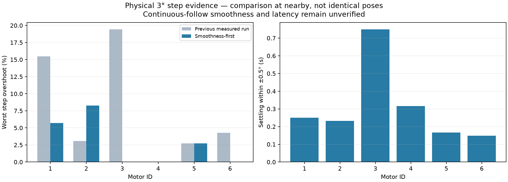
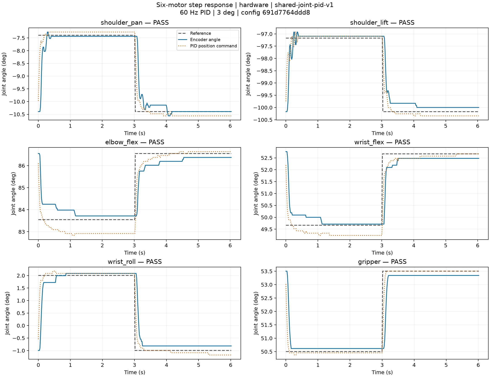

# Smoothness-first following — 2026-10-13

The user selected smooth motion and reduced overshoot over the former <100 ms
latency target. This release updates the one shared controller, deployed remotely,
and the saved desktop scene. The simulator remains a read-only observer during
physical following. Continuous six-axis following is **not yet accepted**: the
white trigger again reported a confirmed input-voltage fault before manual motion.

## Cause and implemented control

The old velocity prediction enabled after two same-direction samples, then cleared
immediately on a plateau/reversal. Quantized references repeatedly switched the lead.
Recorded input replay reproduces command jumps on very small reference increments.
The original proportional/integral correction also learned moving lag as load bias.
These are identified software contributors, not proof that all mechanical jitter is gone.

- All six joints: `velocity_feedforward_s=0`; no predictive velocity lead.
- Two identical reference low-pass poles, tau=25 ms; exact zero-order-hold update.
  A reference step is monotonic; no extrapolation. The actuator can still overshoot.
- Integral learning weight `1/(1+(max(|v_ref|,|v_meas|)/0.25)^2)` retains static bias
  and reduces transient integration. P, I, D gains and their output limits remain unchanged.
- D stays on filtered measurement, avoiding a target-derivative kick.
- Holds reset shaper/PID state; normal trajectory dwell preserves continuity.
- Circle period is now 16 s, previously 4 s. Original <0.01 rad joint error and
  <5 mm Cartesian/circle error checks remain unchanged. All demos share this control.
- Native P/I/D, EEPROM, calibration and voltage limits are preserved. Runtime native
  acceleration/velocity are restored on exit. White leader remains passive.

The shaper has approximately 50 ms low-frequency delay, in addition to servo lag.
The earlier <100 ms analyzer threshold is retained; it is not redefined to claim a pass.
See the [control block diagram and equations](../../lerobot-control.md).

Config SHA-256: `691d7764ddd87a2e6e62a10719e521076ba42e2173c4b7a64332133ea4770439`. [Exact configuration](control.json).

## Physical response evidence

Both candidate and final runs completed all 12 outward/return 3° steps. The final
run passes the existing motor-response criteria, and this report's narrower small-step
checks: worst overshoot ≤10%, last-0.75 s peak-to-peak ≤0.25°, and ±0.5° settling ≤1 s.
This is a bounded step assessment, not a continuous-motion or full-workspace guarantee.
The narrow criteria were selected during tuning and are not an independent holdout test.

| Motor | Previous → current overshoot (%) | ±0.5° settling (s) | 10–90% rise (ms) | Tail peak-to-peak (°) |
| --- | ---: | ---: | ---: | ---: |
| 1 shoulder_pan | 15.49 → 5.71 | 0.250 | 187 | 0.000 |
| 2 shoulder_lift | 3.09 → 8.26 | 0.233 | 964 | 0.000 |
| 3 elbow_flex | 19.44 → 0.00 | 0.750 | 1418 | 0.000 |
| 4 wrist_flex | 0.00 → 0.00 | 0.315 | 1032 | 0.000 |
| 5 wrist_roll | 2.72 → 2.72 | 0.167 | 166 | 0.000 |
| 6 gripper | 4.28 → 0.00 | 0.149 | 97 | 0.000 |




The long 10–90% times on some axes are real: the response enters ±0.5° sooner,
then the final few encoder ticks converge slowly. These values are **not** live
leader-to-follower latency. Reducing overshoot carries this cost; it is not hidden
by reporting only settling time. Previous measurements used a nearby, not identical
pose, and are an engineering comparison rather than controlled system identification.

The first candidate used integral velocity scale 0.1 rad/s. Increasing it to 0.25
improved worst motor-2/3/4 10–90% times from 2318/1820/1999 ms to the values above,
while retaining maximum overshoot below 10%. Both raw runs remain available.

- [Final metrics and native restoration](hardware-summary.json), [CSV](hardware-response.csv), [PDF](hardware-response.pdf)
- [Full final response](hardware-result.json.gz), [remote control trace](hardware-control.json.gz)
- [First candidate metrics](first-hardware-summary.json), [first candidate trace](first-hardware-result.json.gz)
- [Explicit smooth-step verdict](smooth-step-acceptance.json)

## Recorded-input replay and simulation

[Replay comparison](replay-command-comparison.json) uses the same historical
reference and measured encoder samples for each controller. It cannot predict the
changed physical feedback and is not a new hardware trial. Controllers reset when
frames leave `following`, limits are ±3 rad, and only adjacent samples <40 ms apart
are compared. Count condition: |reference increment| <0.3°, |command increment| >0.8°.
Residual events can reflect smooth continuation/deceleration rather than chatter.
Inputs are [wrist](../follow-retune-2026-10-13/wrist-normal-trace.json.gz),
[coupled movement](../follow-retune-2026-10-13/elbow-final-confirmed-trace.json.gz),
[trigger](../follow-retune-2026-10-13/trigger-after-cable-trace.json.gz).
Baseline source is Git commit `540a51a`, with [baseline parameters](baseline-control.json).

All 12 final MuJoCo steps pass. Its inner position actuator is an approximation;
these are not measured motor curves. [Metrics](simulation-summary.json),
[curves](simulation-response.png), [raw data](simulation-result.json.gz).
The separate [surrogate sweep](surrogate-metrics.json) assumes first-order actuator
lags of 40/80/150 ms and a constant 0.025 rad bias; it is qualitative model evidence only.

## Interrupted continuous-follow trial

The first smoothed candidate reached live following, then received white motor-6
`Input voltage error!` / Status=1. The process remained online and held black safely;
post-hold voltage readbacks of 5.2–5.3 V do not invalidate the earlier packet fault.
No manual motion was requested after the alarm. The final integral refinement has
no accepted dynamic capture. [Complete interrupted trace](live-interrupted.json.gz).
No voltage threshold, status mask or motor protection was weakened.

Remaining validation: after healthy white-arm feedback is restored, record each
joint's continuous motion, reversals, abrupt stops and stationary pauses; report
actual lag, reversal overshoot and stationary jitter. Do not infer these from the
step results or claim that all real following is now smooth.

## Verification and reproduction

```sh
./scripts/lerobot-arm verify motors --backend hardware --execute --amplitude 3 --dwell 3 --output logs/smooth-hardware
./scripts/lerobot-arm verify motors --backend mujoco --amplitude 3 --dwell 3 --output logs/smooth-simulation
./scripts/lerobot-arm demo follow --control-log /home/xy/Research/lerobot/logs/smooth-live.json
```

Local full regression: **580 passed, 1 skipped** (upstream hardware package is installed remotely).
Remote deployed suite: **321 passed**. File hashes, calibration identity and native register
restoration are recorded in [delivery verification](delivery-verification.json).
