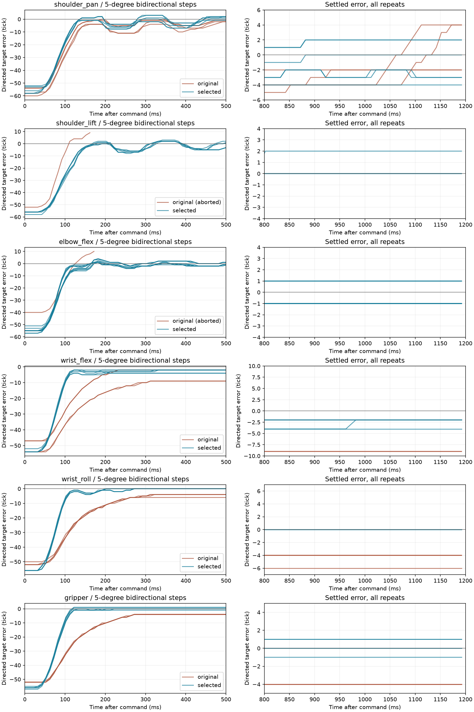

# Six-axis native PID tuning near a held pose — 2026-10-17

The assembled follower was tuned on the robot computer at its current pose and load.
244 candidate, baseline and repeated-validation trials were recorded, followed by
independent bidirectional steps, sinusoidal tracking and simultaneous holding.
The selected seven-register profiles were written to EEPROM, locked, and verified
through a fresh serial connection. No physical power cycle was performed.

This is a measured, smoothness-oriented compromise within the tested neighborhood,
not a global optimum or proof of full-workspace tracking performance. The earlier
single-servo/simple-load settings were not assumed valid for this assembled arm.

## Applied settings

| ID / joint | P | I | D | CW/CCW deadzone | Integral limit | Startup force |
|---|---:|---:|---:|---:|---:|---:|
| 1 / shoulder_pan | 40 | 0 | 64 | 2 | 8 | 16 |
| 2 / shoulder_lift | 32 | 4 | 80 | 0 | 8 | 12 |
| 3 / elbow_flex | 56 | 8 | 128 | 1 | 48 | 4 |
| 4 / wrist_flex | 48 | 4 | 96 | 1 | 16 | 8 |
| 5 / wrist_roll | 48 | 2 | 96 | 0 | 8 | 16 |
| 6 / gripper | 48 | 4 | 64 | 0 | 16 | 16 |

These are native register values, not SI-unit gains for the software outer PID.
Startup force and integral limit use separate one-byte registers 24 and 25.
The [manufacturer's STS register table](https://ftservo.github.io/ftservo-wiki/reference/parameter/memory-sts/)
defines the coefficients, deadzones and storage lock behavior. Search trials used
Lock=1; only the final, already-active profiles were rewritten with Lock=0, then
Lock=1. All six readbacks had Torque_Enable=1 and Status=0. Mechanical origins,
encoder settings, limits and protection parameters were unchanged. Native
Acceleration=0 and Goal_Velocity=0 were retained during these experiments.

## Independent response measurements

Steps move between center −2.5° and center +2.5° (approximately 5° total), with
three repeats in each direction. Values below are the worst over retained steps;
steady error uses the last 300 ms, and jitter the last 400 ms of each 1.2 s step.
One tick is approximately 0.0879°.

| ID | Command → 90% (ms) | Peak steady error (tick) | Settled jitter, peak-to-peak (tick) | Overshoot (tick) |
|---|---:|---:|---:|---:|
| 1 | 125.1 | 4 | 1 | 3 |
| 2 | 142.8 | 2 | 0 | 4 |
| 3 | 155.6 | 1 | 0 | 4 |
| 4 | 111.1 | 4 | 2 | 0 |
| 5 | 105.6 | 0 | 0 | 0 |
| 6 | 109.1 | 1 | 0 | 1 |

The initial ID 1 baseline had 8-tick settled motion. IDs 2 and 3 exceeded the
8-tick overshoot rejection threshold, so those baseline traces are explicitly
marked aborted; no full steady-state metrics are inferred from them. Initial
IDs 4/5/6 had worst steady errors of 9/6/4 ticks respectively. IDs 4 and 5 did not
reach 90% in every baseline step; ID 6's worst baseline t90 was about 260 ms.

The local strict acceptance band is steady error ≤2 tick, jitter ≤2 tick,
overshoot ≤3 tick, t90 ≤200 ms and sample gaps ≤25 ms. Only IDs 5 and 6 passed
all of these checks. IDs 1/4 retain up to 4 ticks (0.352°) of settled error;
IDs 2/3 retain up to 4 ticks of overshoot. Thus neither sub-tick accuracy on every
motor nor 50 ms response has been achieved. The selected profiles favor smooth
holding rather than more aggressive gains that produced larger oscillations.

The left column shows the first 500 ms of every recorded step; the right column
shows 800–1200 ms. Positive directed error means overshoot. Transient ringing is
still visible, particularly on IDs 1 and 2, despite stable final holding.

## Holding and continuous tracking

Following the final EEPROM write, all six joints were observed for a full
10 seconds without goal or torque commands. Peak-to-peak encoder motion was
0 tick on every joint. Peak goal error was 1 tick on ID 3 and 0 on the other five.
This separate pose-holding result does not replace the step endpoint errors above.
An earlier full-arm hold had 1-tick motion and 2-tick peak error on ID 3; both
records are retained so the final hold is not presented as a universal guarantee.

Each axis also tracked a 0.5 Hz sine wave with amplitude 17 ticks (about ±1.49°)
for six seconds. Raw target/position traces and dynamic RMS errors are included
in `verification.json.gz`. Dynamic tracking error includes lag and is distinct
from steady precision. These are native command-to-encoder measurements, not
white-arm-to-black-arm latency tests or external mechanical angle measurements.
The simulator and software outer PID were not in this test loop. The existing
following controller was not retuned by this experiment.

## Acquisition and retained evidence

All targets remained in the first captured pose's ±5° envelope and EEPROM limits.
Supporting joints stayed powered throughout. Targeted refinement used the original
anchor, so repeated searches could not drift the authorized neighborhood. Profiles
with excessive overshoot or persistent motion were rejected, their partial traces
retained and original tuning restored. Temperature, torque, bounds and device
fault checks remained active; voltage-only warnings retained the existing policy.

Feedback was requested at 100 Hz; the worst gap across retained verification steps
was 11.36 ms. One original ID 3 segment had an 87.77 ms gap and was excluded from
response scoring. Its full trace is retained under `excluded_segments`. ID 3 was
retested with unchanged gains; all valid original steps were pooled with the six
new steps, rather than replacing the entire first run with a faster repeat. An
intermediate search also stopped after a corrupt packet; no missing samples were
fabricated. The reusable search permits only one immediate retry after a short
failed read, records retries and stops on repeated failures.

- [Selected settings and mechanical reference](selected-settings.json)
- [EEPROM write and reconnect readback](applied-settings.json)
- [All 244 search-trial summaries](search.csv)
- [Baseline/final comparison](comparison.csv)
- [Original baseline traces, including aborted responses](baselines.json.gz)
- [Independent verification, including excluded segment](verification.json.gz)
- [Full post-persistence hold samples](post-persist-hold.json.gz)

`completed` denotes acquisition or application completion, not passing every
performance threshold. Trial scores in `search.csv` retain the score used in each
round; the overshoot weight was increased during refinement, so scores should not
be ranked across rounds. Compare raw metrics and the independent verification.
The full search logs remain in ignored local and robot-host log directories.
Shared artifacts omit host addresses, account paths and USB serial identifiers.

The reusable command and options are documented in [native-pid.md](../../native-pid.md).
It tests candidates in RAM and does not automatically persist a winner. Reproduce
this experiment only with the corresponding installation, load, clear travel and
mechanical reference. The shared outer-controller defaults remain unchanged.
