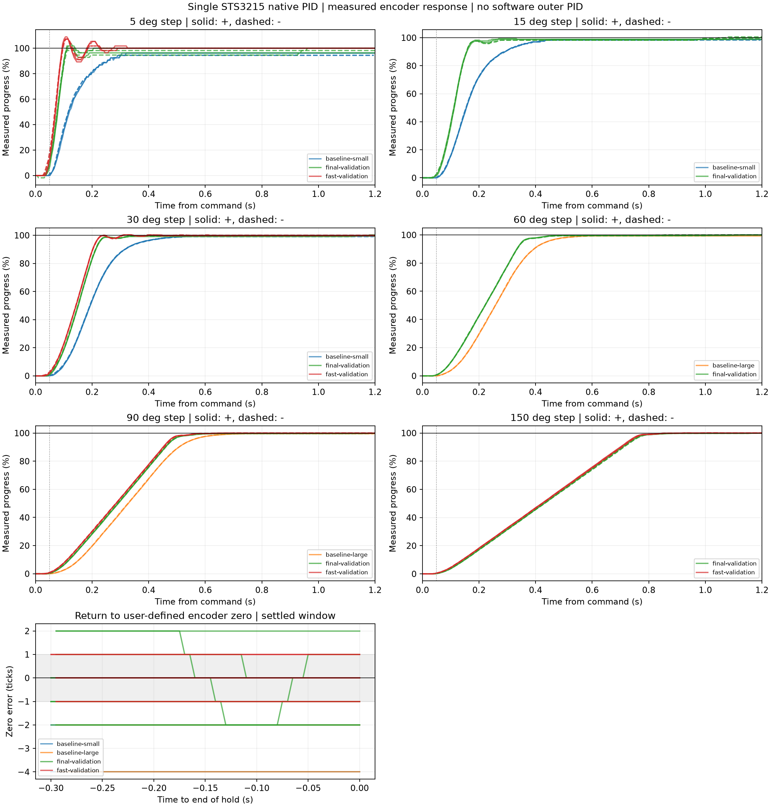
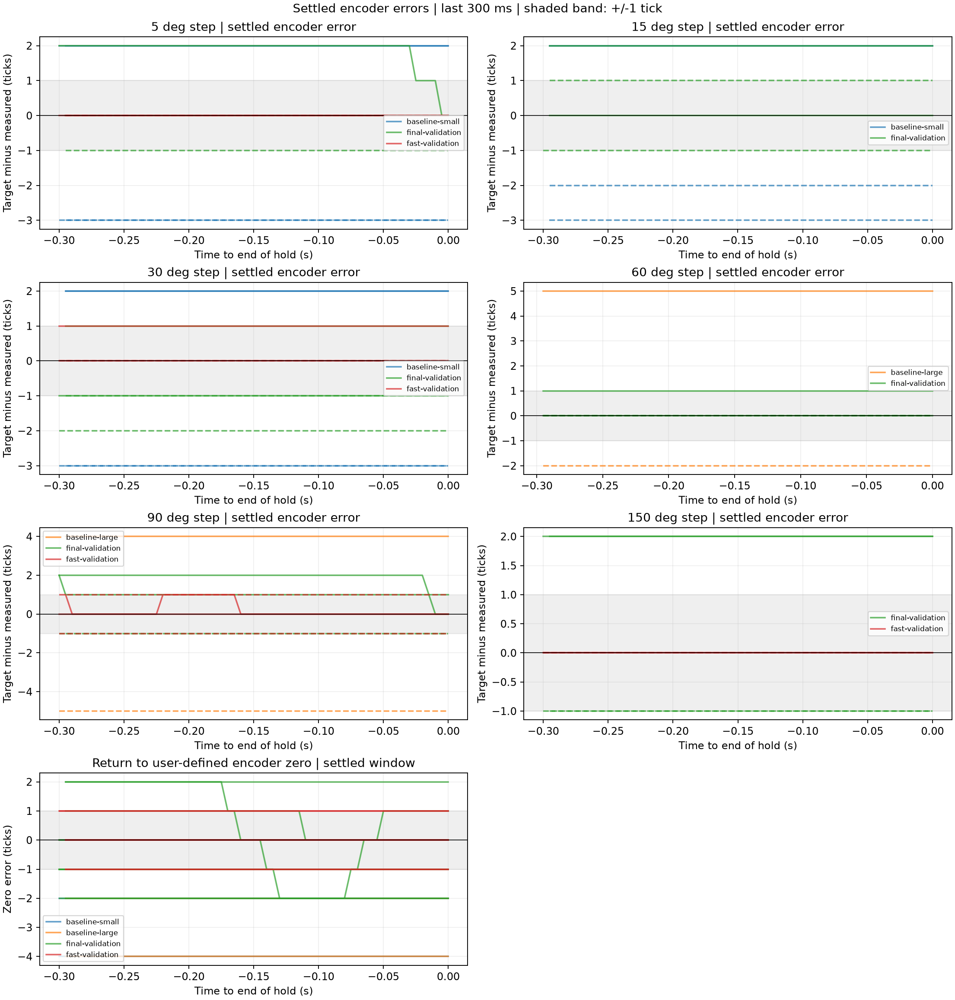

# Single STS3215 native position-loop tuning

**The strict goals were not achieved:** every settled encoder sample below one
tick, repeatable zero below one tick, and command-to-90% within 50 ms. The finite
hardware experiments and restoration completed successfully. This is a single
black-arm ID 1 with a simple load, not a six-axis following acceptance.

The user prepared the zero and authorized clear travel within ±90°. The saved
origin is **2067 raw ticks**, captured with torque off (21 identical readings).
The largest full step tested was **150°**, from −75° to +75° and back, inside that
envelope. Homing_Offset −1110, Phase 12, position mode 0, encoder scale 1 and EEPROM
limits 844..3440 remained unchanged. No EEPROM unlock was issued.

## Measured comparison

All timing columns below are medians across both step directions and repetitions.
Error and overshoot are worst-case across the same segments. Steady error uses
every sample in the last 300 ms of each hold; it is not an average-error pass.
One tick is 360/4096 = 0.08789°. Baselines used 1.2 s holds; final trials 1.5 s.

| Full step | Original t90 (ms) | Smoother t90 (ms) | Faster t90 (ms) | Faster 10–90% rise (ms) | Faster steady peak (ticks) | Faster overshoot (ticks) |
| --- | ---: | ---: | ---: | ---: | ---: | ---: |
| 5° | 254.2 | 100.7 | 89.2 | 44.4 | 0 | 5 |
| 15° | 291.9 | 156.4 | — | — | — | — |
| 30° | 316.0 | 212.9 | 202.4 | 128.0 | 1 | 1 |
| 60° | 394.3 | 334.4 | — | — | — | — |
| 90° | 506.6 | 459.3 | 452.5 | 340.9 | 1 | 1 |
| 150° | — | 710.2 | 702.5 | 560.8 | 0 | 1 |

| Native register values | Original | Smoother (`final-validation`) | Faster (`fast-validation`) |
| --- | ---: | ---: | ---: |
| P / I / D | 16 / 0 / 32 | 48 / 8 / 96 | 64 / 4 / 128 |
| CW / CCW deadzone | 1 / 1 | 0 / 0 | 0 / 0 |
| Integral limit | 0 (unclamped) | 8 | 8 |
| Minimum startup force | 16 | 0 | 16 |
| Acceleration / Goal_Time / Goal_Velocity | 0 / 0 / 0 | unchanged | unchanged |

The smoother combination limits worst overshoot to 2 ticks (0.176°) across its
final steps, with 1–2 tick worst settled errors. The faster combination improves
settled errors to 0–1 tick but overshoots by up to 5 ticks (0.439°) at 5°. Its 150°
steps end at exactly the target throughout all four final settled windows. This
does not erase its one-tick errors at 30°/90° or its one-tick zero-return errors.
Zero-return worst error is 2 ticks for smoother and 1 tick for faster.

The faster trial detects ≥2 ticks of initial movement after 31–46 ms. Its 5°
10–90% rise is about 44 ms, but its command-to-90% is 89 ms. These definitions must
not be substituted for each other to claim a 50 ms large-angle response.





## Limits revealed by the experiments

The long-step trajectories approach a constant slope despite the different gains.
Native load/output reaches 1000 (full scale), with position-derived peak speed
about **218°/s over 50 ms windows**. At that measured speed, covering 90% of a 90°
step alone takes about 372 ms, before acceleration and settling. Raising P further
cannot remove this measured saturation. P96/I4/D128 exceeded the bounded overshoot
allowance; P64/I8/D192 also aborted on excessive zero-return overshoot. Both restored
the original settings. Increasing I to 32 with a clamp did not remove all residual
counts. The tested grid is summarized in [tuning-search.csv](tuning-search.csv).

At rest the feedback voltage was 5.3 V; sampled dynamic values included 5.1–7.2 V.
Supply voltage was not adjusted. These readings alone do not identify the exact
motor/gear variant. No conclusion about absolute sub-tick shaft accuracy follows
from the internal encoder; that needs an independent angle reference. Further
hardware speed/gear/load changes require a separate validation.

## Saved evidence and reproduction

- `baseline-small.json.gz`, `baseline-large.json.gz`: original native gains.
- `final-validation.json.gz`: smoother candidate, six amplitudes, two repetitions
  in each direction, both-direction zero returns.
- `fast-validation.json.gz`: faster candidate, four amplitudes with the same
  repetitions and zero returns.
- `zero.json`: origin and register fingerprint. `candidate-settings.json` records
  experimental values; it does not change normal demo configuration.
- `summary.csv` / `summary.json`: per-segment metrics and zero-return results.
- PNG / SVG / PDF figures are generated from the retained compressed samples.

From the project root, regenerate in an environment with matplotlib:

```sh
./scripts/lerobot-arm verify native-pid report \
  docs/measurements/native-pid-single-joint-2026-10-16/baseline-small.json.gz \
  docs/measurements/native-pid-single-joint-2026-10-16/baseline-large.json.gz \
  docs/measurements/native-pid-single-joint-2026-10-16/final-validation.json.gz \
  docs/measurements/native-pid-single-joint-2026-10-16/fast-validation.json.gz \
  --output logs/reproduced-native-pid
```

See [native benchmark usage](../../native-pid.md) before any new motion experiment.
The [manufacturer memory table](https://ftservo.github.io/ftservo-wiki/reference/parameter/memory-sts/)
defines position P/D/I registers 21/22/23, deadzones 26/27, integral clamp 25 and
Lock 55. Register coefficient integers are device-specific, not SI-unit PID gains.

Final independent readback: **P16/I0/D32, deadzones 1/1, integral limit 0, startup
force 16, Lock=1, Torque_Enable=0, Status=0, Present_Position=2067**, 26°C, 5.3 V.
All final trial restoration error lists are empty. Candidate values were not
persisted or applied to the assembled-arm demos.

## Subsequent application on 2026-10-16

After these experiments the user selected the faster candidate for black ID 1.
The changed values were written with Lock=0 and then relocked. An independent new
connection confirmed **P64/I4/D128, deadzones 0/0, integral limit 8, startup force
16, Lock=1, Torque_Enable=0, Status=0 and raw 2067**. Zero, phase, mode and EEPROM
limits match the experiment fingerprint. See [applied-settings.json](applied-settings.json).
This readback does not include an actual physical power-cycle test.

The initial post-write check exposed an installed SDK table error: startup-force
address 24 had a two-byte width, overlapping integral-limit byte 25. Its readback
was 2064 (=16+256×8), although the actual startup byte was 16. The native diagnostic
now uses the manufacturer's one-byte definition for each address, independently
verifies 16 and 8, and includes regression coverage without changing the shared SDK
table. The historical response samples and candidate settings above are unchanged.
