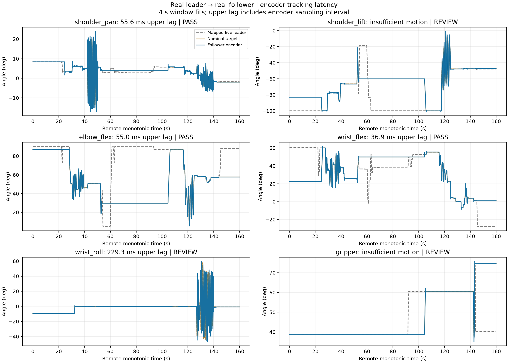
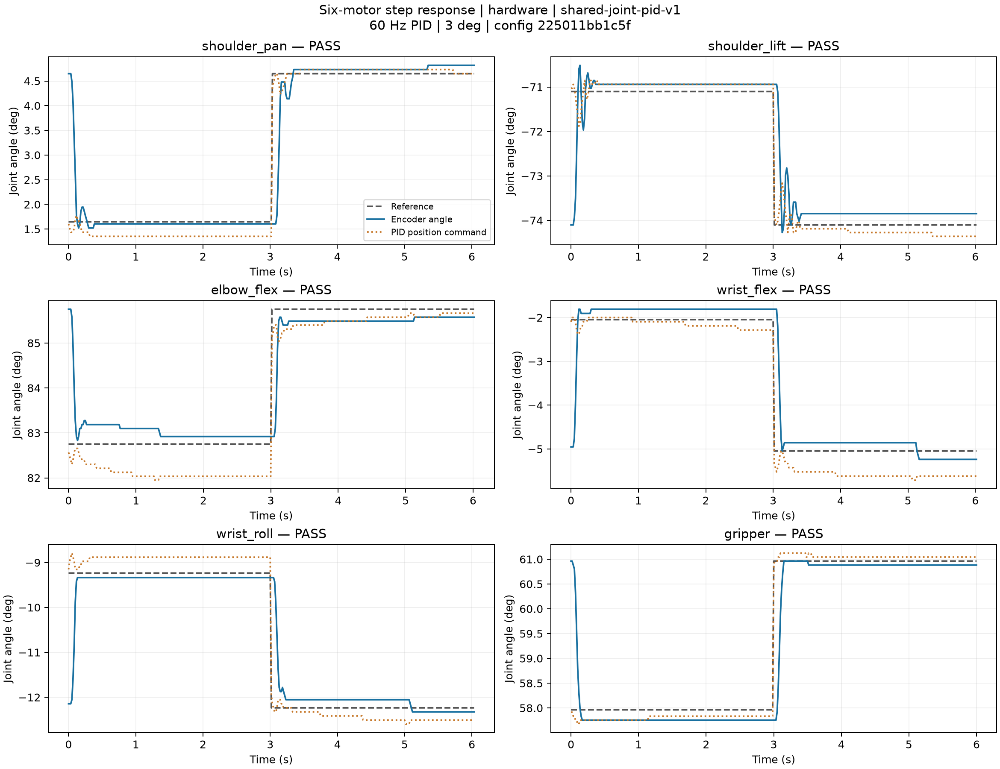

# Remote-only following and overshoot tuning — 2026-10-12

The robot computer owns both buses and performs acquisition, calibrated angle mapping,
startup alignment, shared 60 Hz PID and follower writes. The simulator only subscribes
to one-way telemetry. A real 30-second run without a simulator, including two observer
disconnections/reconnections, stayed in `following`: sequence 281 → 461 → 641.
The process exited normally and held the follower. See [independence checks](independence.json)
and the [full remote trace](independence-trace.json.gz).

## Controller changes

- Velocity feedforward is cleared within one tick on stop or reversal. A decreasing
  lead is applied immediately; only increasing lead retains its 4 rad/s slew limit.
  The filtered velocity cannot apply lead opposite to the new target direction.
- Motor 3 (`elbow_flex`) velocity lead is reduced from 80 to 60 ms. Other channels
  retain 80 ms and the reference filter remains 15 ms.
- Pan Kp/Ki: 0.20/1.50 → 0.12/1.20; lift: 0.25/1.50/0.02 → 0.10/0.80/0.03
  (Kp/Ki/Kd), with D filter 80 → 40 ms; wrist flex Kp/Ki: 0.25/1.50 → 0.10/0.80;
  gripper Kp: 0.50 → 0.35. Wrist roll feedback gains are unchanged.
- The same PID/configuration serves all demos. Gravity-load integration is retained.
  Push-T now checks actual predicted contact height and allows bounded settling at
  chunk boundaries; prediction and execution copy the same controller state.
- A white-trigger fault remains a fault even when the SDK raises on its confirmation
  read. It holds motion and requires explicit resume; monitoring stays available.
  An interrupted guided acquisition cannot pass solely on its earlier good windows.

Exact final [control parameters](control.json) SHA-256:
`225011bb1c5f9f4a61ee7b92c0a7a0a220eae4f2277b6b62038f80e3386ba8ae`.
The [follow mapping](follow.json), both independent joint calibrations and canonical
black MJCF are preserved. No servo EEPROM, native P/I/D, voltage threshold or power
supply setting was changed. Runtime acceleration/velocity are restored on closure.

## Dynamic human-guided trial: partial acceptance



| Motor | Valid 4 s windows | Worst lag plus sampling allowance (ms) | Result |
| --- | ---: | ---: | --- |
| 1 shoulder_pan | 7 | 55.6 | PASS for recorded windows |
| 2 shoulder_lift | 0 | — | Insufficient uninterrupted reversing motion |
| 3 elbow_flex | 7 | 55.0 | PASS for recorded windows |
| 4 wrist_flex | 6 | 36.9 | PASS for recorded windows |
| 5 wrist_roll | 8 | 229.3 | FAIL at this motion speed |
| 6 gripper | 0 | — | Interrupted / insufficient valid motion |

Full [report](dynamic-report.json) and [unmodified remote trace](dynamic-trace.json.gz).
The prior [measurement definition](../follow-latency-2026-10-12/README.md#measurement-definition)
is unchanged. Read-to-command p95 was 5.81 ms (maximum 13.35 ms); that is not motor lag.
Wrist-roll input speed p95 was approximately 5.20 rad/s. Motor speed and load limits
remain relevant; this trial does not pass all six channels below 100 ms.

White `arm1` trigger Status=1 interrupted the trial twice, during the lift/trigger
stages. The worker held correctly. Read-only follow-up samples showed status zero and
5.2–5.3 V; the available evidence does not establish the cause of these intermittent
faults. Only the first interruption was explicitly resumed after clean status readings.
The final acquisition ended before all requested stages completed. The source trace
predates the new `measurement_completed` field; its failure is retained in the report.

### Reversal overshoot observations

The [reversal report](reversal-report.json) compares the previous main recording with
this one. Reference extrema require ≥4° prominence; the follower peak is evaluated
from 80 ms before to 250 ms after each extremum, rejecting sample gaps >50 ms.
These are different human motions, not a matched A/B experiment.

| Motor | Previous worst overshoot (°) | Current (°) | Previous / current input speed p95 (rad/s) |
| --- | ---: | ---: | ---: |
| 1 | 3.18 | 4.24 | 2.05 / 2.22 |
| 2 | 3.89 | 2.55 | 2.22 / 1.25 |
| 3 | 3.28 | 1.10 | 2.85 / 1.37 |
| 4 | 4.46 | 1.12 | 3.91 / 0.90 |
| 5 | 6.64 | 6.22 | 5.85 / 5.20 |
| 6 | No movement | 2.11 | 0 / 1.54 |

Motor 3's recorded peak excursion decreased, but its input was slower. Motor 1 did
not improve on this dynamic statistic. The code change and finite response tests
therefore do not justify a claim of uniformly lower overshoot across all motions.

## Physical and simulation step responses

The twelve 3° steps use the ordinary shared controller and existing acceptance limits:
reach 90%, settle within 3 s and ±0.5°, overshoot ≤35%, maximum feedback gap ≤100 ms.
This test is separate from continuous tracking phase lag and covers one pose/load.
The passive white arm has no commanded response; all six motor curves are black-arm
encoder measurements.

The [intermediate step trial](intermediate-step-result.json.gz) passed all twelve steps;
it used 50 ms elbow feedforward, before the final 60 ms choice. It is retained for
traceability and does not stand in for the final exact-configuration trial.
Two final-trial preflights rejected a one-tick elbow boundary excursion and then an
insufficient self/floor-clearance envelope. Both stopped before step execution;
[boundary](step-boundary-rejection.json.gz) and [collision](step-collision-rejection.json.gz)
records preserve those checks. Subsequent preparation used the existing finite path
controller with local collision checks and fresh-start/limit guards.

### Final exact-configuration hardware result

All **12/12** directions passed with the final configuration hash above. Native
parameters were restored, there was no recorded motor/cleanup error, and the follower
was left holding. The largest final tail absolute error was 0.257°.



| Motor | Previous worst overshoot (%) | Final worst overshoot (%) | Final worst 10–90% rise (ms) | Final worst settling (s) |
| --- | ---: | ---: | ---: | ---: |
| shoulder_pan | 12.7 | 5.6 | 58.4 | 0.267 |
| shoulder_lift | 31.1 | 19.7 | 51.6 | 0.333 |
| elbow_flex | 3.2 | 0.0 | 57.2 | 0.267 |
| wrist_flex | 17.5 | 8.2 | 51.6 | 0.101 |
| wrist_roll | 0.0 | 3.1 | 139.4 | 0.117 |
| gripper | 9.9 | 7.0 | 74.0 | 0.133 |

The previous values are from the [prior final hardware step test](../follow-latency-2026-10-12/hardware-step-summary.json).
Most joints improved in this small-step comparison; wrist roll rose from 0% to 3.1%.
The initial pose differs slightly (and gripper opening differs), so this is not a
matched identification experiment. Motor 3 showed no sampled step overshoot; it does
not imply zero overshoot for every dynamic input or load. Its dynamic reversal result
and slower input speed are reported separately above.

[Summary and per-direction metrics](hardware-step-summary.json), [CSV](hardware-response.csv),
[SVG](hardware-response.svg), [PDF](hardware-response.pdf), [full report](hardware-step-result.json.gz),
[full-rate remote trace](hardware-step-control.json.gz), [guarded preparation](step-anchor-preparation.json.gz).

## Run it

```sh
# Local launcher: all physical control runs remotely.
./scripts/lerobot-arm demo follow
# Optional second local terminal, read-only display:
./scripts/lerobot-arm view follow
# On the robot computer directly:
./scripts/lerobot-arm serve follow --hardware-control --standalone
```

Type `h` + Enter to hold, `e` + Enter to resume, `q` + Enter to hold and quit in the
owning control terminal. Closing the viewer does not stop motion. Closing the owning
terminal does. [Detailed operation and measurement](../../follow.md).


## Regression checks

- Complete local suite: **565 passed, 1 skipped**, including display, full Push-T
  convergence with contact retention, circle and pick/carry/release physics.
- Deployed robot-runtime suite: **312 passed**, using mocked buses; separate from
  the physical trials. No MuJoCo dependency is introduced on the robot computer.
- Ruff passes on all changed Python files; `git diff --check` passes.
- Regression coverage includes one-way observer isolation, slow/disconnected viewers,
  duplicate controller exclusion, remote startup without viewer heartbeats, preservation
  of motor faults, incomplete measurement rejection and stop/reversal feedforward.

Evidence: [local tests](local-tests.txt), [remote tests](remote-tests.txt), [Ruff](ruff.txt).
The twelve-step [simulation response](simulation-response.png) also passes; [metrics](simulation-step-summary.json),
[CSV](simulation-response.csv), [full result](simulation-step-result.json.gz). It uses
an approximate actuator model and does not replace physical measurements.

## Deployment and last online check

The [deployment/postflight record](deployment-and-postflight.json) verifies **204 shared
files** byte-for-byte, including runtime sources, parameters, documentation, both
calibration files and saved scene parameters. Software deployment matches.

The final independent online read returned `There is no status packet!` for both
arms. Consequently that record marks online calibration/health verification as
unavailable and overall postflight as unsuccessful; it does not assert healthy,
connected motors. The completed hardware trial immediately before this check did
verify native parameter restoration and hold. Its saved result is retained separately.
