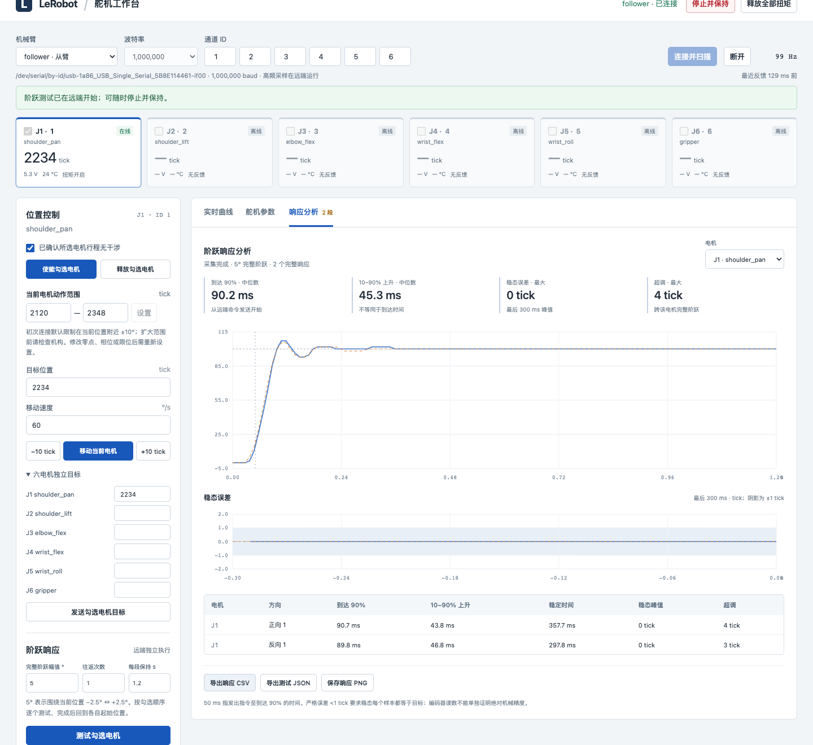
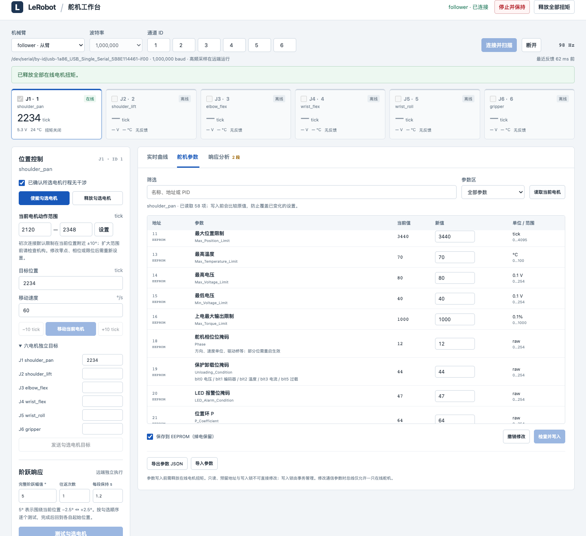

# Servo workbench functional acceptance — 2026-10-16

The complete browser/API/SSH/physical-motor workflow passed. This is a functional
acceptance of the new six-slot interface, **not a 50 ms motor-performance pass**.
Six-channel scheduling, motion and fault paths are covered by offline bus fixtures;
only the installed black follower ID 1 is physically motion-tested here. The other
five configured IDs were absent and correctly remained offline.

An isolated Playwright-driven Chrome tested:

- Six visible motor slots, black/white arm selection and disabled initial motion.
- All 58 parameter fields on the installed motor and unchanged reference identity.
- Temporary P64 → P63, independent readback, then P64 restored using EEPROM mode;
  integral limit 8 and startup-force byte 16 remained distinct and unchanged.
- Invalid P255 rejected before writing; factory fields and the managed lock read-only.
- Position enabling at fresh measured pose, six independent target inputs,
  a checked-channel +10-tick move and a single-channel return.
- Real loss of browser heartbeat: the remote worker held after its 1.5 s timeout,
  cleared enabled channels and required explicit reenable. Stale display blocked
  new motion while stop remained available.
- A 5° full step in both directions, native PID response graphs, per-direction
  metrics and downloaded JSON/CSV.
- Retained native settings, final torque off, Lock=1 and Status=0.
- Mobile layout with no horizontal page overflow; no browser script/console errors.

The user reported restoring motor power before acceptance. The saved mechanical
zero remains raw 2067 and Homing_Offset remains −1110. This session operated around
its current starting pose rather than redefining that zero. All tested positions
were inside the user's previously confirmed ±90° mechanical envelope.

## Recorded response

| Direction | Command-to-90% ms | 10–90% rise ms | Settled peak ticks | Overshoot ticks | Largest sample gap ms |
| --- | ---: | ---: | ---: | ---: | ---: |
| positive | 90.66 | 43.80 | 0 | 4 | 10.35 |
| negative | 89.78 | 46.79 | 0 | 3 | 10.19 |

Sampling was approximately 100 Hz. Native P/I/D = 64/4/128, deadzones 0/0,
integral limit 8, startup force 16. The final acceptance started at raw
2234 and ended at raw 2234.
The response file includes arm/port/baud/model, per-motor reference registers,
native parameters, command timestamps and complete feedback samples.

The measured 5° command-to-90% response remains about 90 ms, above the requested
50 ms performance goal. Other retained trials include one-tick settled errors;
this run's zero-count final step windows do not establish universal sub-tick
accuracy or all-load performance. See the [native PID report](../native-pid-single-joint-2026-10-16/README.md).

## Evidence and reproduction

- [browser-report.json](browser-report.json): all browser/physical assertions and measured summary.
- `response.json.gz`: full remote response record and per-motor native parameters.
- [response.csv](response.csv): downloaded raw response samples.
- The optional browser test is `tests/browser/servo_workbench.cjs`; physical execution
  requires its explicit `--hardware` flag and the same inspected installation.
- Full local regression: 666 passed, 1 skipped. Full remote regression: 431 passed.
  Python Ruff and JavaScript syntax checks passed.

See [workbench operation](../../servo-workbench.md) for setup, parameter storage,
mode constraints, physical motion controls and data export.
