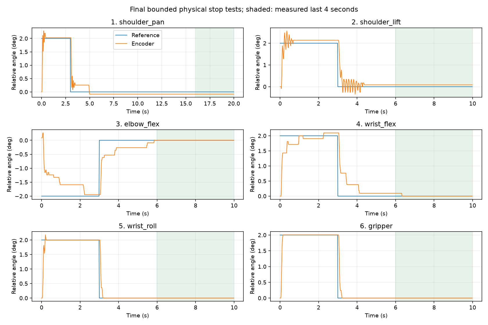

# 主从跟随静态抖动修复 — 2026-10-19

操作者报告白臂不动、肩/肘带动黑臂持续颤动。最终候选实机观察反馈：
**“停止后已稳定，没有持续颤动”**。控制仍全部运行在机器人计算机，
simulator 不参与控制；本次没有修改标定、EEPROM、工作模式、限位或报警保护。

## 日志复现与控制修改

远端 `follow-1792338388956436356.json` 中，肩关节目标约 −90.5° 的驻留段
出现约 8 Hz 振荡。提取的 45.20–50.18 秒窗口内目标仅变化 0.092°，
编码器峰峰值 2.22°，命令峰峰值 1.54°。
[实录片段](recorded-shoulder.json) 记录原日志哈希；
[回放曲线](recorded-replay.png) 与 [回放数据](replay.json) 保留相同编码器反馈。
外层 D 对测量振动持续生成反向目标；引入参考速度权重后，回放命令逐帧
RMS 变化下降约 96%。这是软件命令回放结果，不是物理振幅降低 96% 的证明。

最终共享配置见 [control.json](control.json)，算法与公式见
[控制说明](../../lerobot-control.md)。

- 六轴外层 D 权重为 `v_ref² / (v_ref² + 0.1²)`；静止时减弱，
  0.5 rad/s 时保留约 96% 阻尼，权重不会被黑臂自身颤动重新激活。
  原来的参考滤波时间、补偿限幅、抗饱和和看门狗继续工作。
- 肩、肘原生 I 在运行时临时设为 0，原生 P/D 不变；外层积分保留静态负载补偿。
  `locked_i_coefficients` 由共享控制入口执行，因此跟随、手动及其他运动入口一致。
  电机必须已有 Lock=1，预检在任何目标/使能写入前拒绝未锁定存储；不自动解锁。
  写入读回确认，退出或释放恢复原 I。真故障电机保留待恢复记录，不强行写入。
- 底座误差死区从 0.0015 调至 0.003 rad，约两个编码器 tick，
  避免对约两 tick 的摩擦残差不断积累补偿，形成数 tick 的慢回摆。

## 实机结果与未采用的候选

在经模型采样检查的姿态附近，肩部 2° 往返可复现运动停止后的振荡。
原控制最后 4 秒肩部峰峰值 **17 tick，约 1.45°**；仅抑制外层静态 D 后，
这次肩部尾段为 0 tick，但操作者仍看到肩/肘带动整臂颤动。
随后六轴补测也记录到约 5 tick 的慢回摆，因此没有把 D 单独修改算作完成。

临时比较原生参数后，I=0 且原 P/D 不变的候选在肩、肘观察轮中稳定，
操作者确认停止后无持续颤动。降低肘部 P 至 24 的候选触发 loaded-motion-stall
保护，已排除；全部原值已读回恢复，没有放宽保护。
[搜索记录](native-search.json.gz)、[操作者观察轮](operator-observation.json.gz)。

最终共享实现自动设置并恢复 I，完成六轴各一次 2° 往返。
底座在该轮仍有慢回摆，增大其死区后单独进行了长驻留复测。
以下均为停止后的最后 4 秒，底座使用这次独立复测，其余轴使用最终六轴轮：

| 轴 | 编码器峰峰值 (tick) | 平均位置误差 (tick) | 命令峰峰值 (tick) |
| --- | ---: | ---: | ---: |
| 1 底座 | 0 | −1 | 0 |
| 2 肩部 | 0 | +1 | 0 |
| 3 肘部 | 0 | 0 | 0 |
| 4 腕部俯仰 | 1 | +0.083 | 0 |
| 5 腕部旋转 | 0 | 0 | 0 |
| 6 夹爪 | 0 | 0 | 0 |



[最终六轴实录](final-six.json.gz)、[底座最终复测](final-pan.json.gz)、
[统计、源文件哈希与回归结果](delivery-summary.json)。
本轮是一个核对过的姿态附近的小幅停止测试，不代表全工作空间、所有负载或
高速圆轨迹都已重新验收，也不证明光学末端静止精度优于一 tick。
曲线仍包含起停后的短暂衰减振荡和个别轴缓慢收敛；本次没有将其作为零超调或低延迟验收通过。
初始相邻姿态的纯静态对比没有起振；运动后停止才成功复现，相关原始记录仍保留。

## 退出与回归

所有测试进程已退出，黑臂在当前位置保持，白臂被动。
最后双臂共 12 电机在线、Status=0，独立标定身份一致。
肩、肘原生 I 已分别恢复为启动前 4、8，原生 P/D、零偏、限位与 Lock 保持原值；
运行时加速度和 Goal_Velocity 恢复为 0。
[最终双臂读回](final-readback.json)、[原生寄存器读回](final-native.json)。

本地完整回归 **807 passed, 1 skipped**，远端 **551 passed**，Ruff 通过。
测试覆盖实录 8 Hz 回放、运动中 D 阻尼、静态负载积分、临时 I 的重启/退出恢复、
未锁定存储在写入前拒绝、写入失败保持与跨 demo 配置一致性。

重新启动即可使用新配置：

```sh
./scripts/lerobot-arm demo follow --start-held
```

先确认当前白臂映射姿态和运动空间，`e` 回车对齐并跟随，`h` 回车保持，
`q` 回车退出。既有间歇电压报警仍会保持并要求显式恢复，本次未屏蔽它。
