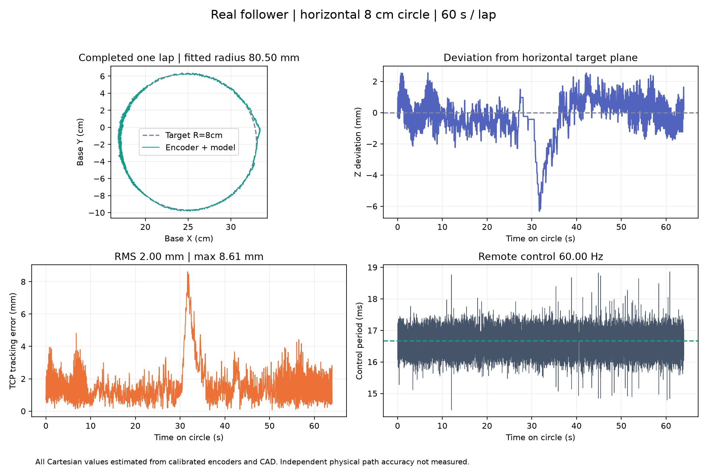
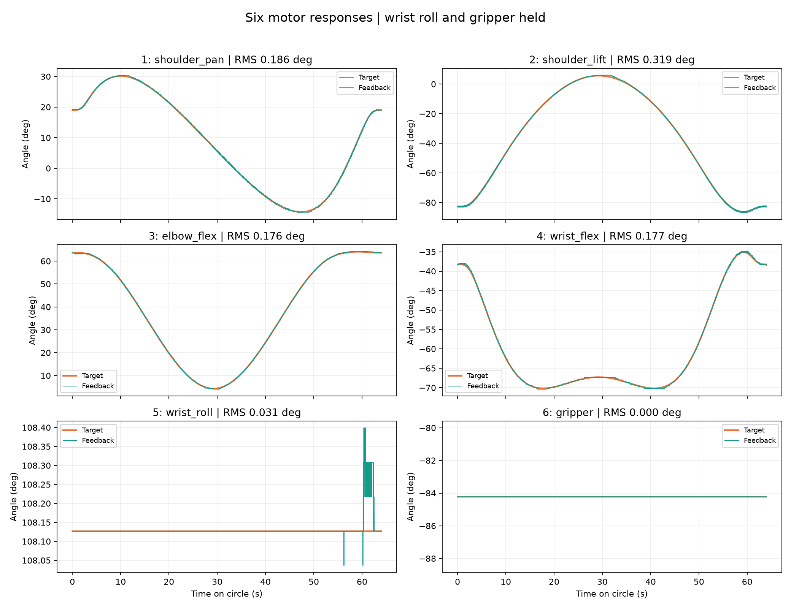

# 黑臂水平 8 cm 圆：2026-10-18

真机完成一圈，结束后六轴保持扭矩；全程没有设备报警、受阻或通信中断。
白臂未参与；本地负责轨迹规划、碰撞检查与观测，远端独立产生轨迹目标并运行共享控制器。

- 轨迹：[已验证参数和 721 个关节点](../../../data/trajectories/table-circle-8cm.json)。
- 基座坐标圆心 `[0.25, -0.017, 0.34] m`，XY 水平面，半径 `0.08 m`。
- 桌面在基座坐标 `z=-0.0024000017 m`，TCP 高度约 `34.24 cm`。
- 一圈匀速周期 `60 s`，启动/停止速度渐变 `4 s`；实际运行圆周阶段约 `64 s`。
- 从实测当前位置进入，耗时 `1.63 s`，不经过旧 Reset 姿态；5、6 号保持目标不变。
- 用户确认装配未改变、基座平放同一桌面、实际 TCP 高约 34 cm、夹爪空载并清空现场。

## 完整控制日志的结果

| 项目 | 编码器与标定模型推算 |
|---|---:|
| 圆周阶段记录 | 3840 帧 |
| 控制频率 | 60.00 Hz |
| 圆周阶段最长控制周期 | 18.86 ms |
| TCP 对时序目标 RMS / 最大误差 | 2.00 / 8.61 mm |
| TCP 对理想圆的几何 RMS / 最大误差 | 1.78 / 8.46 mm |
| XY 轨迹拟合半径 | 80.50 mm |
| 离目标水平面最大偏差 | 6.31 mm |
| 设备报警数 | 0 |

最大偏差出现在约 32 秒附近，不能只用拟合半径评价跟踪精度。
5、6 号未做动态激励，因此本次不能作为它们的动态性能验收。
所有笛卡尔数值都来自编码器与 CAD/角度标定，**没有独立相机或尺子测量整圈真实轨迹**。

完整指标：[hardware-report.json](hardware-report.json)。
离线两圈动力学预测最大几何误差 1.32 mm、无穿透接触；
见 [dynamics-report.json](dynamics-report.json)。
这不是实机精度证据。规划的模型限位余量至少 13.72°，软件工作范围余量至少 106 tick。
夹爪实测角度超出通用 CAD 默认关节范围；保持当前原始读数，没有虚构新的夹爪零点。
动力学检查仅在内存模型中将夹爪约束扩展到已实测的原始工作范围，规范 MJCF 未修改。

## 保存与参数变化

软件角度文件将 1 号零偏变更对应的参考点统一平移 `-104 tick`，保留原来的角度比例与
60° 独立检查误差。夹爪仅更新实际 EEPROM 限位身份。迁移记录保留旧指纹与源文件哈希，
未改写电机零偏或 EEPROM。六轴原生 P/I/D 和存储锁在试验前后逐项一致。
共享命令范围使用当天已由用户手动示教并小幅验证的六轴范围。

旧复位姿态仍保留原始身份；它与新参考及工作范围不一致，必须重新示教才能使用。
旧白臂→黑臂夹爪映射记录的是 10 月 13 日端点，与新范围不同，
后续主从跟随需要重新核对映射；范围检查会拒绝扩宽命令范围。
这次没有执行白臂主从跟随或修改其标定。

本地完整原始记录在 `logs/table-circle-8cm-2026-10-18/`，包括状态、全速控制帧、迁移前参考与参数。
日志不提交 Git。按 [圆轨迹使用说明](../../circle-trajectory.md) 运行时仍需检查当次现场空间。
