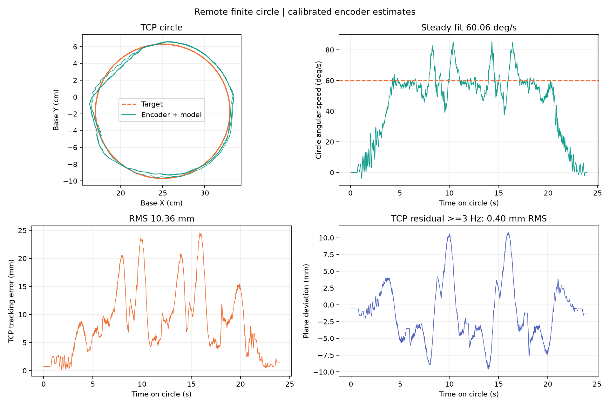
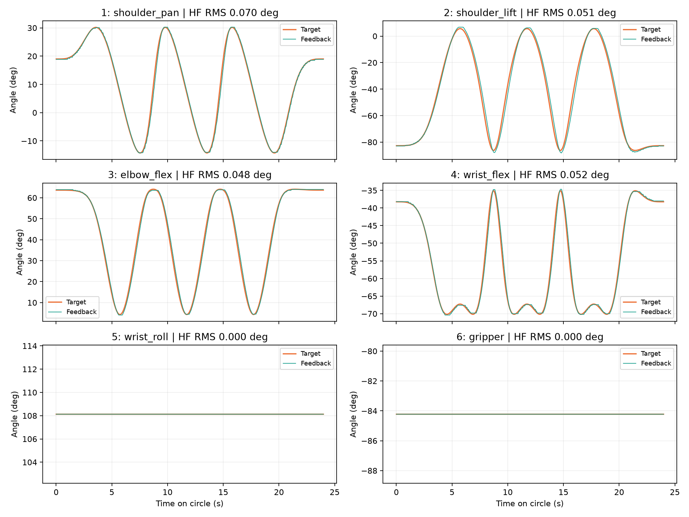

# 水平 8 cm 圆：60°/s 与启停平顺性

黑臂完成真机三圈。最终采用 `smooth-circle-v1`：圆周匀速段目标 60°/s，
运行期加速度寄存器 16，启动和停止各用 6 秒速度渐变。用户观察最终一轮后确认
“起步和停住可以接受”。机械臂已保持，六轴扭矩保留，全程没有设备报警。

这是优先平顺性的实测折中，**没有实现每一瞬间都精确保持 60°/s，也没有达到毫米级动态跟踪精度**。
降低加速度减少了高频残差，同时增大了滞后。不能只看平均速度或高频指标宣称所有性能达标。

## 轨迹与控制

轨迹是 [table-circle-8cm.json](../../../data/trajectories/table-circle-8cm.json)，
基座坐标圆心 `[0.25, -0.017, 0.34] m`、半径 0.08 m、XY 水平面。
桌面 `z=-0.0024000017 m`，几何与当天已核对的慢速圆相同。
匀速一圈 6 秒，对应 TCP 线速度 8.38 cm/s；60°/s 指圆周相位速度，各关节速度不同。
三圈圆周阶段 24 秒，其中包括 6 秒启停额外时间；进入轨迹另计，最大 0.1 rad/s。
5 号腕转与 6 号夹爪保持不变，夹爪 raw=570，不用旧 Reset。

所有任务继续使用 `PositionFeedback` 算法。高速自由空间圆通过计划中的
`execution_profile.controller_profile` 显式选择 `smooth-circle-v1`；
[control.json](control.json) 保存完整共享配置，`circle_position_feedback` 只记录与默认档不同的值。
原有手动、主从跟随、抓取及推物仍用已验证的默认参数档，不把高速前馈套到接触动作。
直接全局套用时，两项抓取接触测试和一项推物接触连续性测试失败；
恢复任务间明确的参数选择后，原测试要求全部通过，没有放宽物体保持或精度断言。

| 关节 | 外环 Kp | Ki | Kd | 速度前馈时间 / s |
|---|---:|---:|---:|---:|
| 1 shoulder_pan | 0.08 | 0.4 | 0 | 0.120 |
| 2 shoulder_lift | 0.06 | 0.3 | 0 | 0.135 |
| 3 elbow_flex | 0.08 | 0.4 | 0 | 0.120 |
| 4 wrist_flex | 0.06 | 0.3 | 0 | 0.115 |

前四轴参考整形为两级 25 ms 极点，参考速度滤波 25 ms，误差滤波 100 ms，
反馈修正变化率 0.12 rad/s，积分速度权重尺度 0.15 rad/s。
取消这四轴软件测量微分，避免与原生位置环阻尼叠加；原生 D 保留。
具体限幅、死区、5/6 号设置以保存的完整配置和报告中展开的 profile 为准。

| ID | 原生 P | I | D |
|---|---:|---:|---:|
| 1 | 40 | 0 | 64 |
| 2 | 32 | 4 | 80 |
| 3 | 56 | 8 | 128 |
| 4 | 48 | 4 | 96 |
| 5 | 48 | 2 | 96 |
| 6 | 48 | 4 | 64 |

这些原生 PID 在本次全部试验中未修改。加速度与目标速度只在 RAM 中修改，
退出后读回均恢复为 0；六轴 Lock=1、Torque_Enable=1。
没有修改零偏、相位、EEPROM 限位、保护、电压或启动输出。
原生加速度寄存器单位为 8.7°/s²，因此 16 对应约 139°/s²；
目标速度寄存器请求值 3000，实际单位受 Phase 控制，不能无条件当作物理 tick/s。
寄存器定义见 [FEETECH 官方表](https://ftservo.github.io/ftservo-wiki/reference/parameter/memory-sts/)。

## 最终实机结果

| 指标 | 最终一轮 |
|---|---:|
| 圆周阶段控制帧 | 1440 |
| 控制频率 / 最长运行周期 | 60.00 Hz / 18.13 ms |
| 匀速段相位拟合平均角速度 | 60.06°/s |
| 约 117 ms 平滑速度的 P5 / P50 / P95 | 46.52 / 58.19 / 79.34°/s |
| TCP 对时序目标 RMS / 最大误差 | 10.36 / 24.60 mm |
| TCP 对理想圆几何 RMS / 最大误差 | 5.53 / 11.81 mm |
| ≥3 Hz TCP 跟踪残差 RMS | 0.405 mm |
| 设备报警 | 0 |

| 关节 | 跟踪 RMS / ° | 最大跟踪误差 / ° | 超出目标极值的超调 / ° | ≥3 Hz 残差 RMS / ° |
|---|---:|---:|---:|---:|
| 1 | 0.953 | 3.788 | 0.076 | 0.070 |
| 2 | 3.326 | 7.618 | 1.926 | 0.051 |
| 3 | 1.476 | 3.198 | 0.262 | 0.048 |
| 4 | 0.966 | 2.902 | 0.437 | 0.052 |

2 号是主要动态误差来源，仍有约 1.93° 极值超调；本次不宣称零超调。
5、6 号未受动态激励，不能以两条水平曲线推断它们的运动性能。





## 调整过程与取舍

下表使用同一个 `diagnostics/circle_response.py` 对原始 60 Hz 记录重新计算。
第一组在相同 30°/s 下比较，避免把不同速度的误差直接当作控制器提升比例。

| 30°/s 两圈 | 加速度寄存器 | TCP 时序 RMS / mm | ≥3 Hz TCP 残差 / mm |
|---|---:|---:|---:|
| 原软件参数 | 254 | 5.43 | 1.32 |
| A：降低外环 PI、取消前四轴软件 D、增加前馈 | 254 | 3.83 | 0.76 |
| B：继续降低原生加速度 | 96 | 3.90 | 0.54 |

随后完成 45°/s、60°/s 试验及前馈调整。用户反馈 60°/s 的主要问题在启停，
于是继续降低加速度并延长速度渐变。所有中间结果在 [comparison.json](comparison.json)，没有只保留最小误差的一轮。

| 60°/s 三圈 | 启停渐变 / s | 平均速度 / °/s | TCP 时序 RMS / mm | ≥3 Hz TCP 残差 / mm | 观察 |
|---|---:|---:|---:|---:|---|
| C：加速度 96，复测 | 2 | 59.92 | 4.89 | 0.514 | 仍有明显启停顿挫 |
| D：加速度 32 | 2 | 59.90 | 6.90 | 0.566 | 明显更平顺 |
| D：加速度 32 | 4 | 60.02 | 6.33 | 0.461 | 启停仍有顿挫 |
| 最终：加速度 16 | 6 | 60.06 | 10.36 | 0.405 | 起步和停住可以接受 |

高频残差不含低频滞后或速度起伏。不同渐变时长产生不同匀速采样窗口，
所以不能把这个指标的下降单独解释为整条轨迹精度提升。

最初有一轮在进入阶段因客户端“stale remote feedback”退出，保持 ACK 往返约 1.67 秒，
而远端控制仍在工作。随后将已验证的有限圆任务改为远端自持时钟、独立输出线程，
不再依赖本地显示心跳；该失败轮没有计入速度验收。远端仍检查原生反馈时限、故障、
扭矩、受阻和有限执行截止时间；收到终止信号仍保持退出。普通手动控制保留客户端看门狗。

## 测量边界、复现与证据

TCP 全部由编码器与标定 CAD 推算，**没有独立相机测量整圈真实位置或机械振动**。
平均速度是去掉启停段后的相位线性拟合；速度分位数先平均 7 个控制样本。
振动指标对匀速跟踪残差去线性趋势、均匀重采样后使用 Hann 窗频谱，累计 ≥3 Hz 能量。
短任务若没有足够匀速段，工具仍画曲线，但把匀速/频谱指标标为 null，不制造验收结果。

```sh
./scripts/lerobot-arm verify tracking --execute --from-current --laps 3 \
  --plan data/trajectories/table-circle-8cm.json
```

执行前按 [圆轨迹说明](../../circle-trajectory.md) 检查现场。
该轨迹绑定当前机器标定；其他账户/机器人需要自己的设备配置、标定和验证。
本地只做碰撞/预算检查与事后分析，参考产生和全部真机闭环在远端。

- [hardware-report.json](hardware-report.json)：最终完整指标、展开控制档和退出后原生参数。
- [hardware-control.json.gz](hardware-control.json.gz)：最终完整控制帧；报告的 trace SHA256 是解压后 JSON 的哈希。
- [control.json](control.json)：执行时完整共享配置快照。
- [comparison.json](comparison.json)：十轮完成试验的统一指标、配置/轨迹/原始记录哈希。
- 最终原始文件名：`tracking-trial-1792329404775014000.json`、`tracking-trace-1792329404775014000.json`。

最终控制配置 SHA256：`128afd839657a771b130caf7e9273dafa521204df46a7f64df3b9210fafa7562`。
轨迹 SHA256：`d1d92f282053ad3c1f2f70efdfe469001a64124d1b5cc4d95c2142b6c1c96a57`。
角度标定 SHA256：`acb0d391485df339b9fd31dba78c753ddf1774a6d95312d1b646bdf6423e4652`。

最终检查：本地完整回归 **752 passed, 1 skipped**（本机缺少可选 LeRobot SDK 的官方默认值对照）；
之后新增的错误控制档拒绝用例连同全部圆播放测试 **13 passed**。
最终远端完整回归、两端修改文件 Ruff 静态检查及 `git diff --check` 均通过，
具体远端测试数见 [verification.json](verification.json)。
[final-readback.json](final-readback.json) 保存只读原生寄存器和两端文件哈希核对结果。
完整源码及参数以该报告所在 Git 提交为准。
