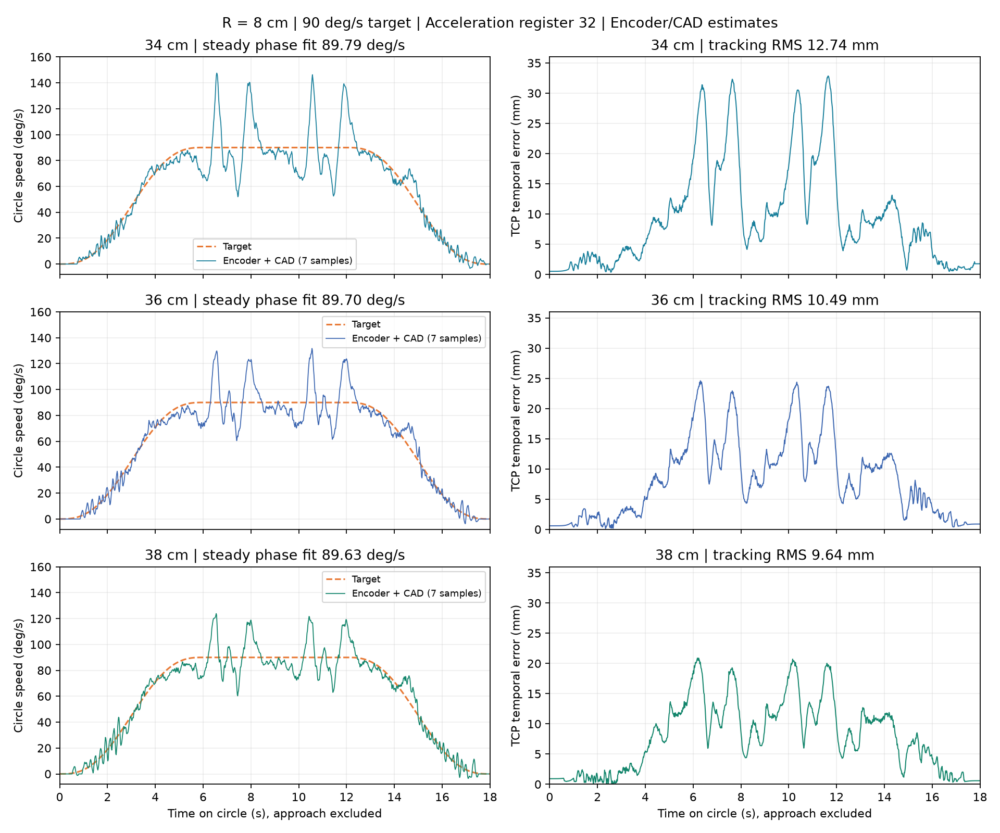

# 90°/s 水平圆：34 / 36 / 38 cm 高度测试

三个高度各完成真机三圈，半径均为 8 cm，运行期加速度寄存器 32。
相位平均速度分别为 89.79、89.70、89.63°/s，三个高度全程设备报警为 0。
38 cm 在本次试验中的位置误差最小；这不是整个工作空间的最优高度结论。

**平均速度接近 90°/s，但瞬时速度仍明显波动，动态精度未达到 5 mm。**
所有 TCP 数据由编码器与标定 CAD 推算，不是独立相机测量。

## 实测结果

下表来自远端 60 Hz 完整控制帧；RMS 和最大误差包含圆周启停，但不包含进入轨迹。
平均速度只拟合匀速段相位。

| 桌面以上高度 | 平均圆周速度 | 对时序目标 RMS / 最大误差 | 对理想圆几何 RMS / 最大误差 | ≥3 Hz 残差 RMS |
|---|---:|---:|---:|---:|
| 34 cm | 89.79°/s | 12.74 / 32.84 mm | 7.67 / 19.69 mm | 0.49 mm |
| 36 cm | 89.70°/s | 10.49 / 24.59 mm | 6.28 / 13.45 mm | 0.55 mm |
| 38 cm | 89.63°/s | 9.64 / 20.89 mm | 5.89 / 12.38 mm | 0.50 mm |

速度的 7 帧平均（约 117 ms）P5–P95 分别为：34 cm **60.54–137.77°/s**，
36 cm **68.11–123.85°/s**，38 cm **71.62–118.50°/s**。
不能用低于 1 mm 的高频残差掩盖这些低频速度起伏和约 1 cm 的时序误差。



2 号肩部仍是主要跟踪误差来源。逐关节结果和全部响应曲线：

- 34 cm：[指标](h34-report.json)、[TCP 曲线](h34-trajectory.png)、[六关节曲线](h34-joints.png)。
- 36 cm：[指标](h36-report.json)、[TCP 曲线](h36-trajectory.png)、[六关节曲线](h36-joints.png)。
- 38 cm：[指标](h38-report.json)、[TCP 曲线](h38-trajectory.png)、[六关节曲线](h38-joints.png)。

5 号腕转与 6 号夹爪保持不变；本次不能作为它们的动态响应验收。

## 路径与高度筛选

三条路径的基座坐标 XY 圆心均为 `[0.25, -0.017] m`，半径 0.08 m，
桌面 `z=-0.0024000017 m`。所以三个 TCP 平面的基座 Z 分别为
0.3375999983、0.3575999983、0.3775999983 m。工具倾角约束和初始圆周相位相同，
腕转与夹爪保持同一实测姿态，夹爪 raw=570。

30 cm 候选在维持原工具倾角、当前 IK 分支及已示教范围时，首点残差约 6.40 mm，
没有通过，因此没有执行。这个结果不表示该高度在所有工具倾角下都不可达。
采用 34/36/38 cm 可以保持相同工具倾角，只比较高度变化。

三个已执行路径的采样 CAD 碰撞、原生命令范围和速度/加速度预算检查通过。
规划最大关节速度分别约 79.61、70.49、63.90°/s；最大关节加速度约
219.50、178.80、151.11°/s²。前者和圆周相位 90°/s 是不同量。
规划端点距软件命令范围的最小角度余量约 8.50°。
每次执行前，从实测姿态重新检查完整进入段，并在远端核对绑定证明和新鲜反馈。
没有使用旧 Reset，没有关闭限位、故障、失扭矩或受阻保护。

近似 MuJoCo 动力学预测无穿透碰撞，但没有通过原来 5 mm / 0.01 rad 的严格动态精度检查。
完整失败指标保存在 [planning.json](planning.json)，没有放宽阈值或把它记为精度通过。
该模型也没有实现原生加速度寄存器的全部轨迹限制，不能用它替代实机结果。
本次在用户确认空载、在旁观察且清空空间后，作为有监督的性能实验执行。

## 加速度不足的基线也保留

第一轮直接使用 60°/s 圆的加速度 16，在 34 cm 测试 90°/s，虽然平均相位速度
90.83°/s，但 TCP 时序 RMS **39.68 mm**、最大 **132.89 mm**，
几何 RMS **22.41 mm**。该轮动作完成，不代表跟踪性能通过。
其速度 P5–P95 为 −1.70–201.34°/s，已经出现短暂倒退和大幅追赶。
完整 [指标](baseline-h34-acc16-report.json)、[控制档](baseline-control.json)、
[轨迹](baseline-plan.json) 与原始控制帧均保留。

加速度 16 约为 139.2°/s²，低于该路径约 219.5°/s² 的关节需求。
改为 32（约 278.4°/s²）后，在同一 34 cm 高度，时序 RMS 降为 12.74 mm、
最大误差降为 32.84 mm。这个对比也说明只看平均圈速会误判跟踪成功。

`smooth-circle90-v1` 继承 `smooth-circle-v1` 的外环 PI、前馈和参考滤波，
只覆盖运行期原生加速度为 32；全部参数在 [control.json](control.json)。
原生六轴 P/I/D、零偏、相位、原生限位、启动输出、死区、保护与电压均未修改。
每轮关闭后恢复原来的加速度和目标速度，保留扭矩以支撑机械臂。
[最终只读核对](final-readback.json) 逐项确认这些寄存器与 60°/s 测试后记录一致，
六轴 Status=0、Lock=1、Torque_Enable=1、Acceleration=0、Goal_Velocity=0。

## 启停与复现

匀速阶段每圈 4 秒。为保留平顺启停，两个端部仍各用 6 秒五次速度渐变，
三圈圆周阶段总共约 18 秒，进入段另计（最大 0.1 rad/s）。
多圈时允许渐变长于一圈周期，但有限任务不得让加速/减速段重叠；
该计划不允许只执行一圈，推荐三圈，以得到足够匀速记录。
远端参考和控制独立于本地 simulator；绘图和评分在运动结束后进行。

```sh
./scripts/lerobot-arm verify tracking --execute --from-current --laps 3 \
  --plan data/trajectories/table-circle90-h34cm.json
```

将末尾的 `h34cm` 改成 `h36cm` 或 `h38cm` 可选择另一个已验证场景高度。
使用前检查对应空间，并使用匹配的机器标定；不要把绝对轨迹直接用于另一台机器人。
原来的 `table-circle-8cm.json` 仍是 60°/s、加速度 16，本次没有把它改为 90°/s。

[summary.json](summary.json) 汇总四轮实际指标和哈希。
`*-control.json.gz` 保存完整原始控制帧，报告的 trace SHA256 对应解压后 JSON。
`h34` / `h36` / `h38` 的参数、轨迹、标定哈希与本次共享文件逐项匹配；
基线的配置与轨迹另存，避免用新文件错误解释旧数据。
测试与部署核对结果保存在 [verification.json](verification.json)。

本地完整测试 **758 passed, 1 skipped**（可选 LeRobot SDK 对照未安装），远端完整测试
**506 passed**。两端修改文件 Ruff 检查和 `git diff --check` 通过。
截至归档尚未收到这组三高度的视觉表现反馈，不能宣称已通过肉眼平顺性验收。
